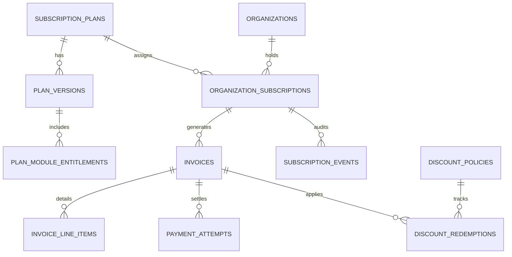

# PHASE E-09.11: BACKEND READINESS & FINANCIAL ENGINE SPECIFICATION
## Comprehensive Future Backend Architecture, Payment Gateway Integration, and Ledger Governance Specification

---

### Purpose & Scope

This specification defines the architectural requirements, domain services, database schemas, webhook handling, security controls, and transaction semantics necessary for future backend phases to implement the server-side monetization and billing engine for the School Management SaaS platform.

> [!IMPORTANT]
> **Strict Non-Implementation Notice:** No backend services, database migrations, controllers, middleware, or payment provider integrations were implemented in Phase E-09.11. This document serves as the formal engineering contract between the finalized Super-Admin frontend workspaces and future backend implementation teams.

---

## 1. Domain Models & Relational Schema Design

Future backend development must implement the following normalized relational entities (PostgreSQL recommended):



### 1.1 `subscription_plans` & `plan_versions`
- **Immutability & Versioning:** Commercial plan definitions must never be mutated in-place if active subscriptions reference them. Any price or quota change must create a new `plan_version`.
- **Fields:**
  - `id`: UUID (Primary Key).
  - `slug`: VARCHAR(64) UNIQUE (e.g. `plan_starter`, `plan_growth`).
  - `tier`: ENUM (`starter`, `growth`, `enterprise`, `custom`).
  - `status`: ENUM (`draft`, `published`, `archived`).
  - `currency`: CHAR(3) ISO-4217 code.
  - `price_monthly_cents`: BIGINT (store monetary amounts in integer minor currency units / cents to eliminate floating-point imprecision).
  - `price_annual_cents`: BIGINT.
  - `price_quarterly_cents`: BIGINT.
  - `max_students`: INT.
  - `max_campuses`: INT.
  - `max_staff`: INT.
  - `storage_gb`: INT.
  - `created_at`, `updated_at`: TIMESTAMPTZ.

### 1.2 `organization_subscriptions`
- **Fields:**
  - `id`: UUID (Primary Key).
  - `organization_id`: UUID (Foreign Key to `organizations`).
  - `plan_version_id`: UUID (Foreign Key to `plan_versions`).
  - `status`: ENUM (`draft`, `trialing`, `active`, `past_due`, `suspended`, `canceled`, `expired`).
  - `billing_interval`: ENUM (`monthly`, `quarterly`, `annual`).
  - `current_period_start`: TIMESTAMPTZ.
  - `current_period_end`: TIMESTAMPTZ.
  - `trial_ends_at`: TIMESTAMPTZ NULL.
  - `grace_period_ends_at`: TIMESTAMPTZ NULL.
  - `cancel_at_period_end`: BOOLEAN DEFAULT false.
  - `canceled_at`: TIMESTAMPTZ NULL.
  - `cancellation_reason`: TEXT NULL.
  - `gateway_customer_id`: VARCHAR(128) NULL (e.g. Stripe `cus_xxx`).
  - `gateway_subscription_id`: VARCHAR(128) NULL (e.g. Stripe `sub_xxx`).

### 1.3 `invoices` & `invoice_line_items`
- **Fields:**
  - `id`: UUID (Primary Key).
  - `invoice_number`: VARCHAR(64) UNIQUE (Sequential human-readable reference, e.g. `INV-2026-0001`).
  - `organization_id`: UUID.
  - `subscription_id`: UUID.
  - `subtotal_cents`: BIGINT.
  - `discount_cents`: BIGINT DEFAULT 0.
  - `tax_cents`: BIGINT DEFAULT 0.
  - `total_cents`: BIGINT (`subtotal - discount + tax`).
  - `amount_paid_cents`: BIGINT DEFAULT 0.
  - `currency`: CHAR(3).
  - `status`: ENUM (`draft`, `issued`, `paid`, `overdue`, `void`, `uncollectible`).
  - `issue_date`: DATE.
  - `due_date`: DATE.
  - `paid_at`: TIMESTAMPTZ NULL.
  - `void_reason`: TEXT NULL.
  - `idempotency_key`: VARCHAR(128) UNIQUE.

### 1.4 `payment_attempts`
- **Fields:**
  - `id`: UUID (Primary Key).
  - `invoice_id`: UUID.
  - `organization_id`: UUID.
  - `amount_cents`: BIGINT.
  - `currency`: CHAR(3).
  - `provider`: ENUM (`stripe`, `adyen`, `flutterwave`, `paystack`, `manual_bank_wire`).
  - `provider_transaction_id`: VARCHAR(128) UNIQUE NULL.
  - `payment_method_type`: ENUM (`card`, `bank_transfer`, `direct_debit`, `cheque`).
  - `sanitized_account_identifier`: VARCHAR(64) (e.g. `Visa ending in 4242`).
  - `status`: ENUM (`pending`, `succeeded`, `failed`, `refunded`).
  - `failure_category`: ENUM (`insufficient_funds`, `card_expired`, `gateway_timeout`, `fraud_risk_hold`, `do_not_honor`, `network_error`).
  - `failure_message`: TEXT NULL.
  - `retry_count`: INT DEFAULT 0.

---

## 2. Subscription Lifecycle Management & State Transitions

The backend subscription engine must enforce the explicit state machine validated in Phase E-09.11:

1. **State Transition Guard:**
   - Any state update must execute inside an ACID database transaction.
   - Updates must verify current status via row-level locks (`SELECT ... FOR UPDATE`) to prevent race conditions or double transitions.
2. **Mandatory Audit Justifications:**
   - Transitions to `suspended` or `canceled` must reject HTTP requests that lack an administrative justification string (`reason.length >= 5`).
3. **Cancellation Semantics:**
   - When a tenant requests cancellation, the backend must set `cancel_at_period_end = true` rather than terminating immediately, allowing access until the prepaid `current_period_end` date arrives.
   - Immediate cancellations (e.g. for Terms of Service violations) must be an explicit super-admin override that sets `status = 'canceled'` and revokes tenant tokens immediately.

---

## 3. Plan Changes, Upgrades, and Proration Engine

When an organization changes plans mid-cycle:
1. **Immediate Upgrades with Proration:**
   - Calculate remaining days in the active billing period:
     $$\text{Remaining Fraction} = \frac{\text{Days Remaining}}{\text{Total Period Days}}$$
   - Credit unused portion of old plan:
     $$\text{Unused Credit} = \text{Old Plan Price} \times \text{Remaining Fraction}$$
   - Charge prorated portion of new plan:
     $$\text{New Plan Charge} = \text{New Plan Price} \times \text{Remaining Fraction}$$
   - Net Proration Invoice:
     $$\text{Net Due} = \text{New Plan Charge} - \text{Unused Credit}$$
   - If Net Due > 0, generate an immediate invoice and charge the saved payment method.
   - If Net Due < 0, credit the customer balance for future invoice deductions.
2. **Downgrades:**
   - Schedule plan downgrades to take effect at `current_period_end` to avoid complex negative proration adjustments.
   - Enforce capacity ceiling validations (e.g. if the school has 3 campuses and downgrades to Starter which allows 1 campus, reject the downgrade until excess campuses are archived).

---

## 4. Payment Gateway Integration Architecture

### 4.1 Multi-Provider Abstraction Layer
The backend must implement a unified `PaymentProviderInterface`:

```typescript
export interface PaymentProviderInterface {
  createCustomer(org: Organization): Promise<{ gatewayCustomerId: string }>;
  setupPaymentMethod(customerId: string, clientToken: string): Promise<PaymentMethodToken>;
  chargeInvoice(invoice: Invoice, paymentMethodId: string): Promise<ChargeResult>;
  createSubscription(params: CreateGatewaySubscriptionParams): Promise<GatewaySubscriptionResult>;
  cancelSubscription(gatewaySubscriptionId: string, atPeriodEnd: boolean): Promise<void>;
  parseAndVerifyWebhook(rawPayload: Buffer, signatureHeader: string): Promise<GatewayWebhookEvent>;
}
```

### 4.2 Webhook Processing & Idempotency Rules
1. **Signature Verification:** Every webhook from Stripe, Adyen, or Flutterwave must be verified using the provider's HMAC SHA-256 signature secret before parsing.
2. **Idempotency Storage:** Store incoming webhook event IDs in an `inbound_webhook_events` table with unique constraint:
   ```sql
   CREATE TABLE inbound_webhook_events (
     id VARCHAR(128) PRIMARY KEY,
     provider VARCHAR(32) NOT NULL,
     event_type VARCHAR(64) NOT NULL,
     payload JSONB NOT NULL,
     status VARCHAR(32) NOT NULL,
     processed_at TIMESTAMPTZ DEFAULT NOW()
   );
   ```
3. **Deduplication:** If an event ID already exists in the table, return `HTTP 200 OK` immediately without reprocessing.
4. **Asynchronous Dispatch:** Webhook handlers must acknowledge delivery (`HTTP 200 OK`) within 2 seconds by pushing the verified event onto an event queue (e.g. RabbitMQ, BullMQ, Amazon SQS) for background worker processing.

---

## 5. Dunning Campaigns & Failed-Payment Recovery

When a renewal payment fails (`payment_intent.payment_failed`):
1. **State Machine Transition:** Update subscription status from `active` to `past_due`.
2. **Grace Period Activation:** Calculate and set `grace_period_ends_at = NOW() + INTERVAL '14 days'`.
3. **Smart Retry Schedule (Exponential Backoff):**
   - Attempt 1: T + 24 hours.
   - Attempt 2: T + 72 hours (Day 3).
   - Attempt 3: T + 168 hours (Day 7).
   - Attempt 4: T + 288 hours (Day 12, final notice).
4. **Automated Communications:** Dispatch dunning emails to the organization's billing contacts with an authenticated link to update payment methods.
5. **Grace Period Expiry Action:** If all retries fail and 14 days elapse, a cron worker transitions the subscription to `suspended`, blocking non-administrative tenant user sessions while preserving historical data.

---

## 6. Taxes, Jurisdiction Rules, and Discounts

1. **Tax Jurisdiction Resolution:**
   - Multi-country SaaS operations must determine tax nexus based on the tenant's validated country, state/province, and VAT/GST registration number.
   - Integrate with tax calculation services (e.g. Stripe Tax, TaxJar, Avalara) to compute exact VAT (UK/EU), GST (Australia/Canada), or US Sales Tax.
2. **Discount Engine:**
   - Validate coupon codes against `discount_policies` table:
     - Check code uniqueness and case-insensitive matching.
     - Verify active date window: `valid_from <= NOW() <= valid_until`.
     - Verify redemption ceiling: `current_redemptions < max_redemptions`.
     - Check plan tier compatibility: `applicable_plans` contains plan tier or `'all'`.
   - Apply discount atomically during invoice generation.

---

## 7. Revenue Recognition & Financial Analytics Engine

1. **Monthly Recurring Revenue (MRR) Calculation:**
   - Compute MRR via background rollup worker (daily at 00:00 UTC).
   - Normalize annual plans to `annual_price / 12` and quarterly to `quarterly_price / 3`.
   - Group strictly by currency:
     ```sql
     SELECT 
       currency,
       SUM(
         CASE 
           WHEN billing_interval = 'monthly' THEN price_monthly_cents
           WHEN billing_interval = 'quarterly' THEN price_quarterly_cents / 3
           WHEN billing_interval = 'annual' THEN price_annual_cents / 12
         END
       ) AS mrr_cents,
       COUNT(id) AS active_paid_subscriptions
     FROM organization_subscriptions
     WHERE status IN ('active', 'past_due')
     GROUP BY currency;
     ```
2. **Zero Cross-Currency Aggregation:** Currency isolation must be maintained in all API responses. The backend must reject requests asking for aggregated revenue totals across multiple currencies without an explicit exchange rate table.

---

## 8. Role-Based Access Control (RBAC) & Tenant Isolation

1. **Super-Admin Authorizations:**
   - Plan authoring, invoice voiding, payment retry simulations, and manual subscription status transitions must require `super_admin` or `billing_administrator` platform roles.
2. **Tenant Access Boundaries:**
   - Tenant school administrators must only ever be able to query invoices and payment records matching their authenticated `tenant_id` from their JWT token claims.
   - Database queries in the tenant API must enforce row-level security (RLS) or mandatory WHERE clauses: `WHERE organization_id = :authenticated_tenant_id`.
3. **Financial Audit Immutability:**
   - All financial events must write to an append-only `financial_audit_log` table with cryptographic SHA-256 chain hashes to prevent retroactive tampering.

---

## 9. Observability, Dead-Letter Queues, and Recovery

1. **Alerting Triggers:**
   - Webhook processing failure rate > 1%.
   - Payment decline spike > 15% in a 1-hour window.
   - Any unhandled exception during invoice generation or recurring billing cron execution.
2. **Dead-Letter Queue (DLQ):**
   - Webhooks that fail processing after 5 worker retries must be routed to a DLQ for administrative replay.
3. **Reconciliation Cron Job:**
   - Daily reconciliation task comparing gateway balance reports with the internal `invoices` and `payment_attempts` tables to detect any unrecorded or mismatched settlements.

---

## 10. Summary of Backend Delivery Phases

When backend development is authorized, implementation should proceed in four disciplined sprints:
- **Sprint 1 (Core Schema & Plans):** Database migrations, plan catalogue versioning, and organization subscription repository.
- **Sprint 2 (Invoicing & Calculation Engine):** Automated invoice generation cron, tax calculation, discount redemption, and PDF rendering.
- **Sprint 3 (Payment Gateways & Webhooks):** Stripe/Adyen SDK integration, webhook verification worker, idempotency layer, and payment settlement.
- **Sprint 4 (Dunning, Analytics & Governance API):** Retry schedules, MRR analytics rollups, and Super-Admin REST/GraphQL endpoints for the finalized frontend workspaces.
