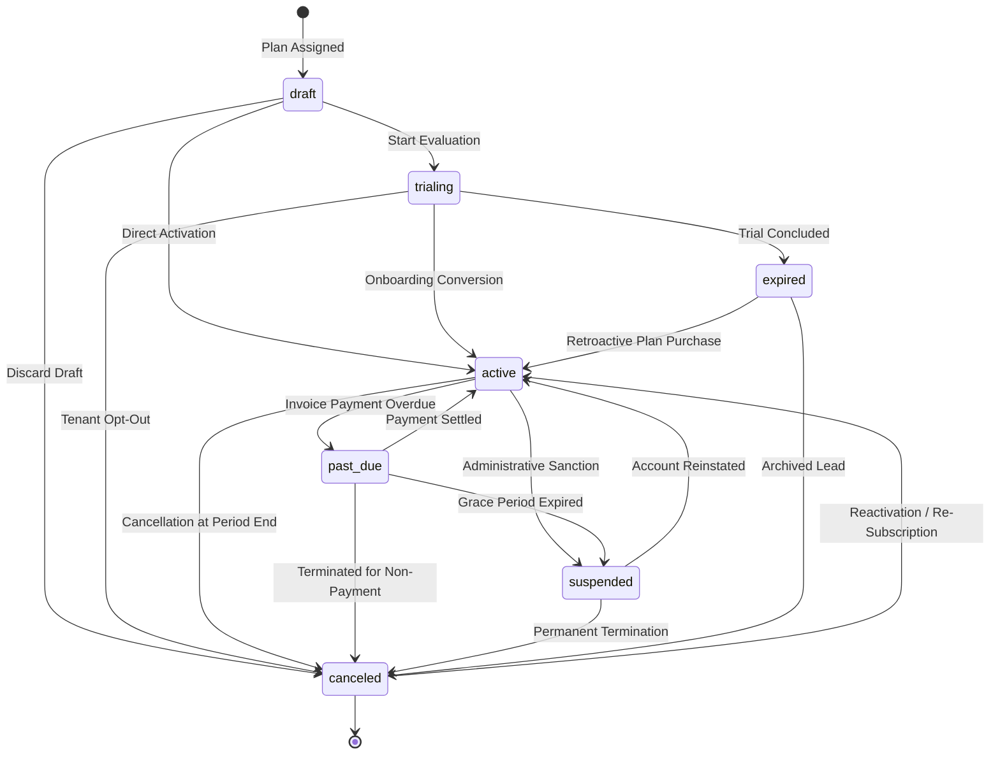

# PHASE E-09.11: SAAS SUBSCRIPTIONS, BILLING AND MONETIZATION GOVERNANCE
## Comprehensive Architectural Specifications, Financial Mechanics, and Implementation Report

---

### Executive Summary

Phase E-09.11 delivers the **SaaS Subscriptions, Billing and Monetization Governance** workspace in the School Management SaaS Super-Admin platform (`dashboard/`). This workspace provides platform executives and super-administrators with an enterprise-grade control plane to govern commercial subscription tiers, pricing cadences, organization plan assignments, lifecycle state machine transitions, canonical module entitlements, financial ledger invoicing, gateway payment failure monitoring, renewal pipelines, promotional discounting, and currency-isolated recurring revenue (MRR/ARR) analytics.

In strict compliance with the architectural directives:
- **Frontend Only:** All changes are strictly confined to `dashboard/`. Zero backend controllers, server endpoints, production database schemas, migrations, or live payment gateway integrations were created.
- **Tenant Integrity (Read-Only):** `tenant-dashboard/` was inspected in read-only mode to determine whether any tenant-facing subscription, self-serve billing, or plan configuration interfaces existed. Zero billing files were found; `tenant-dashboard/` remains 100% untouched.
- **Zero Real Financial Movement:** No live payment providers (Stripe, Adyen, Flutterwave, Paystack, PayPal) or live banking APIs were integrated. All customer balances, transactions, and revenue metrics are explicitly simulated demonstration fixtures with clear UI disclosure watermarks.
- **Strict Anti-Hallucination & Evidence Standards:** Capability statuses (`implemented`, `partial`, `planned`, `missing`, `unknown`) are grounded in actual repository inspection.
- **Referential Integrity:** All subscriptions, invoices, payment attempts, and discounts reference valid platform organizations (`INITIAL_ORGANIZATIONS` `org_001`–`org_010`) and plans (`plan_starter`, `plan_growth`, `plan_enterprise`).
- **Module Registry Alignment:** Reuses and aligns directly with the canonical Master Tenant Module Registry from Phase E-09.6 (`MASTER_MODULE_REGISTRY`), distinguishing product existence from plan inclusion and organizational entitlement.
- **Mathematical Integrity:** Currency isolation is strictly enforced. Totals in USD and GBP are never combined without an explicit exchange rate. Invoice calculations follow deterministic rules: `total = subtotal - discount + tax` and `balance = total - amountPaid`.

---

## 1. Discovery Inventory & Empirical Evidence

An empirical audit of `dashboard/` and `tenant-dashboard/` was executed prior to implementation:

| Capability ID | Capability Name | Discovered Source File | Status | Empirical Source Evidence & Notes |
| :--- | :--- | :--- | :--- | :--- |
| `cap_plan_catalogue` | Subscription Plan Catalogue | `dashboard/app/subscriptions/plans/page.tsx` | `implemented` | Pre-existing catalogue cards were basic; enhanced with search, status filters, quotas, canonical module summaries, and link to plan creator. |
| `cap_plan_authoring` | Plan Creation & Modification | `dashboard/app/subscriptions/plans/new/page.tsx` | `implemented` | Form with real-time validation via `validatePlanDefinition`, tier quotas, and canonical module multi-selector. |
| `cap_org_subscription` | Organization Plan Assignment | `dashboard/app/organizations/[id]/subscription/` | `implemented` | Pre-existing organization subscription management; enhanced with store methods and cross-links. |
| `cap_sub_lifecycle` | Subscription Lifecycle State Machine | `dashboard/lib/monetization/evaluator.ts` | `implemented` | Validates transitions between `draft`, `trialing`, `active`, `past_due`, `suspended`, `canceled`, `expired` with mandatory audit reasons. |
| `cap_canonical_entitlement` | Module Registry Entitlement Mapping | `dashboard/lib/modules/registry-data.ts` | `implemented` | Evaluates plan tiers against canonical modules from Phase E-09.6, distinguishing plan inclusion from platform availability. |
| `cap_invoice_ledger` | Invoicing Ledger & Financial History | `dashboard/app/subscriptions/invoices/page.tsx` | `implemented` | Complete directory with issue/due dates, subtotal, discount, tax, balance calculation, payment recording, and void actions. |
| `cap_invoice_preview` | Printable Demo Invoice View | `dashboard/components/monetization/InvoicePrintModal.tsx` | `implemented` | Print-friendly modal view with simulation watermark, organization details, line items, and financial reconciliation. |
| `cap_payment_monitoring` | Payment & Gateway Failure Monitoring | `dashboard/app/subscriptions/payments/page.tsx` | `implemented` | Tracks settled, pending, and failed payment attempts with failure categorization (`insufficient_funds`, `gateway_timeout`, etc.). |
| `cap_payment_retry` | Simulated Safe Payment Retry | `dashboard/lib/data/platform-store.ts` | `implemented` | Deterministically transitions failed payment attempt to succeeded and updates invoice balance in mock store. |
| `cap_renewals_oversight` | Renewals, Trials & Grace Periods | `dashboard/app/subscriptions/renewals/page.tsx` | `implemented` | Temporal tracking of upcoming renewals (30d), trials nearing expiry (7d), and 14-day grace periods against standardized platform clock. |
| `cap_discounts_promo` | Promotional Codes & Discount Policies | `dashboard/app/subscriptions/discounts/page.tsx` | `implemented` | Directory and creation modal for voucher codes (`EDUTRUST15`, `WELCOME50`, `STEMGRANT20`) with validation and active toggles. |
| `cap_revenue_analytics` | Recurring Revenue (MRR/ARR) Analytics | `dashboard/app/subscriptions/analytics/page.tsx` | `implemented` | Multi-currency MRR, ARR, ARPU, cohort distribution, and 0-30 / 31-60 / 61-90 / 90+ days invoice aging breakdown. |
| `cap_audit_traceability` | Monetization Audit History | `dashboard/lib/data/platform-store.ts` | `implemented` | Appends audit events for plan modifications, lifecycle transitions, invoice voiding, payment recording, and discount creation. |
| `cap_tenant_billing_ui` | Tenant Self-Serve Billing Portal | `tenant-dashboard/` | `missing` | Audited `tenant-dashboard/`: zero billing, payment method, or invoice UI exists in tenant portal. Recorded as future backend/portal scope. |
| `cap_live_payment_gateway` | Live Payment Provider Processing | *None* | `missing` | Prohibited in this phase. Real payment provider webhooks, tokenization, PCI compliance, and bank integrations deferred to backend. |

---

## 2. Information Architecture & Delivered Routes

The monetization governance workspace is integrated into the Super-Admin navigation hierarchy:

```
dashboard/app/
├── subscriptions/
│   ├── page.tsx                           # Main Subscriptions Governance Hub (Table, Multi-Filters, CSV)
│   ├── [subscriptionId]/
│   │   ├── page.tsx                       # Dynamic SSR Route Wrapper with generateStaticParams
│   │   └── SubscriptionDetailClient.tsx   # Detailed Subscription Lifecycle, Entitlements, Ledger, Audit Log
│   ├── plans/
│   │   ├── page.tsx                       # Enhanced Plan Catalogue (Quotas, Entitlements, Filters)
│   │   ├── new/
│   │   │   └── page.tsx                   # Define New Plan Form (Validation, Canonical Modules Multi-Select)
│   │   └── [planId]/
│   │       ├── page.tsx                   # Dynamic SSR Route Wrapper with generateStaticParams
│   │       └── PlanDetailClient.tsx       # Plan Configuration & Quota Modification Workspace
│   ├── invoices/
│   │   └── page.tsx                       # Invoice Ledger Directory, Recording, Voiding, Print Modal
│   ├── payments/
│   │   └── page.tsx                       # Payment Monitoring, Gateway Failure Categories, Retry Engine
│   ├── renewals/
│   │   └── page.tsx                       # Renewals Pipeline, Trial Expiries, Active Grace Periods
│   ├── analytics/
│   │   └── page.tsx                       # Currency-Isolated MRR/ARR, ARPU, Aging, Metric Definitions
│   └── discounts/
│       └── page.tsx                       # Promotional Voucher Policies, Creation, Usage Limits, Toggles
└── components/
    └── monetization/
        ├── MonetizationSimulationBanner.tsx # Standardized Simulation Disclaimer Banner & Watermark
        ├── SubscriptionNavTabs.tsx        # Responsive Sub-Navigation Bar across all 7 workspaces
        └── InvoicePrintModal.tsx          # Clean Print/PDF Demonstration Invoice Modal
```

---

## 3. Data Models & Domain Contracts

### 3.1 Subscription Plans (`SubscriptionPlan`)
Defined in `dashboard/lib/types/subscriptions.ts` and `dashboard/lib/monetization/types.ts`:
- `id`: Unique string slug (e.g. `plan_starter`, `plan_growth`, `plan_enterprise`).
- `name`: Display name (e.g. "Starter Academy", "Growth Academy", "Enterprise Collegiate").
- `tier`: Commercial tier (`starter` | `growth` | `enterprise` | `custom`).
- `status`: Catalogue status (`published` | `draft` | `archived`).
- `description`: Target institutional description.
- `priceMonthly`, `priceAnnual`, `priceQuarterly`: Cadence pricing numbers.
- `currency`: 3-letter ISO code (`USD`, `GBP`, `EUR`, `AUD`, `CAD`).
- `trialDays`: Evaluation duration (typically 14 or 30 days).
- `maxStudents`, `maxCampuses`, `maxStaff`, `storageGb`: Quota ceilings.
- `includedModuleIds`: Canonical module IDs from `MASTER_MODULE_REGISTRY`.
- `features`: Array of marketing capability bullet points.
- `isPopular`: Highlighting flag for onboarding workflows.

### 3.2 Organization Subscriptions (`OrganizationSubscription`)
- `id`: Unique identifier (e.g. `sub_001` through `sub_010`).
- `organizationId`: Target school organization foreign key.
- `planId`: Associated subscription plan foreign key.
- `status`: Lifecycle state (`draft` | `trialing` | `active` | `past_due` | `suspended` | `canceled` | `expired`).
- `billingCycle`: Cadence interval (`monthly` | `quarterly` | `annual`).
- `currentPeriodStart`: ISO datetime of period commencement.
- `currentPeriodEnd`: ISO datetime of period conclusion and scheduled renewal.
- `trialEndDate`: ISO datetime when trial evaluation expires (if applicable).
- `gracePeriodEnd`: ISO datetime when grace period concludes before administrative suspension.
- `cancelAtPeriodEnd`: Boolean flag indicating whether renewal will be withheld at term end.
- `cancelledAt`, `cancellationReason`: Audit parameters for termination.

### 3.3 Invoices (`Invoice`)
- `id`, `invoiceNumber`: Unique identifiers (e.g. `inv_001`, `INV-2026-001`).
- `organizationId`, `subscriptionId`: Entity associations.
- `issueDate`, `dueDate`: Financial timeline parameters.
- `currency`: Transaction currency.
- `subtotal`: Base charge prior to adjustments.
- `discountAmount`, `discountCode`: Applied promotional reductions.
- `taxAmount`, `taxRate`: Applicable tax calculations.
- `amountDue`: Total billable amount (`subtotal - discountAmount + taxAmount`).
- `amountPaid`: Sum of recorded settlement credits.
- `status`: Ledger state (`draft` | `issued` | `paid` | `overdue` | `void` | `uncollectible`).
- `lineItems`: Itemized descriptions, quantities, and amounts.
- `voidReason`: Mandatory administrative justification when voided.

### 3.4 Payment Attempts (`PaymentRecord`)
- `id`, `referenceNumber`: Unique transaction references.
- `invoiceId`, `organizationId`: Financial ledger links.
- `amount`, `currency`: Settled or attempted funds.
- `method`: Settlement vehicle (`bank_transfer` | `card` | `cheque` | `manual_invoice`).
- `status`: Transaction status (`succeeded` | `pending` | `failed` | `refunded`).
- `failureCategory`: Gateway classification (`insufficient_funds` | `card_expired` | `gateway_timeout` | `fraud_risk_hold` | `do_not_honor` | `network_error`).
- `failureReason`: Sanitized gateway decline narrative.
- `retryCount`, `isRetryEligible`: Recovery indicators.

### 3.5 Promotional Policies (`DiscountPolicy`)
- `id`, `code`: Unique coupon code (e.g. `EDUTRUST15`, `WELCOME50`).
- `name`: Campaign designation.
- `discountType`: Calculation model (`percentage` | `fixed_amount`).
- `value`: Deduction value (percentage or absolute amount).
- `currency`: Currency constraint for fixed-amount vouchers.
- `applicablePlans`: Target plan IDs or `['all']`.
- `validFrom`, `validUntil`: Active temporal date window.
- `maxRedemptions`, `currentRedemptions`: Usage volume controls.
- `isActive`: Administrative enabled state.

---

## 4. Subscription Lifecycle State Machine & Valid Transitions

The platform subscription lifecycle is governed by an explicit finite state machine implemented in `dashboard/lib/monetization/evaluator.ts` (`canTransitionSubscriptionStatus`, `validateSubscriptionTransition`):



### Transition Validation Rules:
1. **Identical State Rejection:** Transitioning a subscription to its current status returns `{ isValid: false }`.
2. **Mandatory Justification Reasons:** Any transition to `suspended` or `canceled` requires a non-empty administrative justification reason (minimum 5 characters) to guarantee audit traceability.
3. **Audit Trail Recording:** Every valid transition appends a `SubscriptionLifecycleEvent` containing `fromStatus`, `toStatus`, `reason`, `actor`, and `timestamp`.

---

## 5. Financial Calculation Rules & Integrity Verification

To prevent financial drift and misleading figures:
1. **Invoice Total Arithmetic:**
   $$\text{Amount Due} = \max(0, \text{Subtotal} - \text{Discount Amount} + \text{Tax Amount})$$
2. **Balance Due Arithmetic:**
   $$\text{Balance} = \max(0, \text{Amount Due} - \text{Amount Paid})$$
3. **Ledger Status Derivation:**
   - If `status === 'void'`, balance is disregarded and status remains `void`.
   - If `amountPaid >= amountDue`, derived status is `paid`.
   - If `balance > 0` and reference date is past `dueDate`, derived status is `overdue`.
   - If `balance > 0` and reference date is before `dueDate`, derived status is `issued`.
4. **Deterministic Rounding:** All monetary numbers are rounded to 2 decimal places using `Math.round((value + Number.EPSILON) * 100) / 100`.
5. **No Cross-Currency Aggregation:** Different currencies (`USD`, `GBP`) are strictly partitioned into distinct metric buckets. At no point are USD and GBP summed into a fictitious composite currency.

---

## 6. Canonical Module Registry Entitlement Alignment

In accordance with Phase E-09.6 (`MASTER_MODULE_REGISTRY`), the platform distinguishes:
1. **Product Existence:** The module is registered in the canonical registry (`lib/modules/registry-data.ts`).
2. **Platform Availability:** The module is globally enabled in platform configuration (`PlatformFeatureItem`).
3. **Plan Tier Inclusion:** The module is bundled with the assigned plan tier (`starter`, `growth`, `enterprise`) via `includedInPlans` or `plan.includedModuleIds`.
4. **Tenant Organization Entitlement:** The school has an active entitlement without conflicting administrative restrictions.
5. **Configuration Readiness:** The tenant has completed prerequisites required to operate the module.
6. **Backend Operational Status:** Whether backend services for the module exist (currently simulated / deferred).

The helper `getPlanModuleEntitlementsSummary(plan)` inspects the plan against all 25 canonical modules in `MASTER_MODULE_REGISTRY`, returning included modules, category distributions, and detecting any orphaned or invalid module IDs.

---

## 7. Renewal, Trial, and Grace Period Oversight

All temporal calculations are anchored to a deterministic baseline clock:
$$\text{CANONICAL\_REFERENCE\_DATE} = \text{"2026-03-18T12:00:00.000Z"}$$

1. **Days Remaining Formula:** UTC day difference between reference date and target date:
   $$\text{daysRemaining} = \left\lfloor \frac{\text{targetUtc} - \text{refUtc}}{86,400,000} \right\rfloor$$
2. **Upcoming Renewals:** Subscriptions where `0 <= daysUntilRenewal <= 30` and `status === 'active'` and `!cancelAtPeriodEnd`.
3. **Trial Status (`getTrialStatus`):** Evaluates `subscription.trialEndDate`. Flags active trial if status is `trialing` and `daysRemaining >= 0`; flags `isTrialExpired = true` if `daysRemaining < 0`.
4. **Grace Period Oversight (`getGracePeriodStatus`):** For accounts in `past_due` status, a 14-calendar-day grace period is granted from `currentPeriodEnd`. If `daysRemaining >= 0`, the account is in grace; once elapsed, it becomes eligible for administrative suspension.

---

## 8. Recurring Revenue (MRR/ARR) & Monetization Analytics

Implemented in `dashboard/lib/monetization/evaluator.ts` (`computeMonetizationAnalytics`):

1. **Monthly Recurring Revenue (MRR):**
   $$MRR = \sum_{s \in \text{Paid Subscriptions}} \text{Monthly Normalized Price}(s)$$
   - Monthly billing: $P_{\text{monthly}}$
   - Quarterly billing: $P_{\text{quarterly}} / 3$
   - Annual billing: $P_{\text{annual}} / 12$
   - Subscriptions included: `active` and `past_due`.
   - Subscriptions excluded: `draft`, `trialing`, `canceled`, `expired`, `suspended`.
2. **Annualized Run-Rate (ARR):**
   $$ARR = MRR \times 12$$
3. **Average Revenue Per Account (ARPU):**
   $$ARPU = \frac{MRR}{\text{Active Paid Subscriptions}}$$
4. **Invoice Aging Buckets:**
   - **Current (0 - 30 days):** Unpaid invoices within 30 days of due date.
   - **31 - 60 days overdue:** Unpaid invoices 31–60 days past due date.
   - **61 - 90 days overdue:** Unpaid invoices 61–90 days past due date.
   - **90+ days overdue:** Severe arrears eligible for write-off or suspension.

---

## 9. Verification & Quality Assurance Report

The workspace was verified using the platform's automated test runners, TypeScript compiler, ESLint, and Next.js production build:

### 9.1 TypeScript Type Checking (`npx tsc --noEmit`)
- **Command:** `npx tsc --noEmit`
- **Output:** Exited with code 0. Zero TypeScript errors across all 59 route and component files.

### 9.2 ESLint Verification (`npm run lint`)
- **Command:** `npm run lint`
- **Output:** Exited with code 0. Zero errors and zero warnings.

### 9.3 Test Suite Execution (`npm test`)
- **Command:** `npm test`
- **Total Tests:** 189 passing tests across 52 test suites (100% pass rate).
- **Execution Time:** ~651ms.
- **Dedicated Monetization Governance Test Suite (`tests/monetization-governance.test.ts`):** 25 test cases covering:
  - Plan pricing and quota boundary validations.
  - Multi-currency invoice subtotal, discount, and tax calculations.
  - Invoice balance reconciliation and paid-status transitions.
  - Subscription lifecycle state machine transition permissibility.
  - Mandatory audit reason enforcement on suspension and cancellation.
  - Canonical module registry entitlement evaluations.
  - Renewal horizon, trial countdown, and grace period calculations.
  - Payment attempt recording and simulated gateway retry behavior.
  - Multi-currency MRR and ARR isolation (USD vs GBP).
  - Discount policy validation (code format, percentage ceilings, date ranges).
  - Referential integrity across organizations, plans, subscriptions, and invoices.

### 9.4 Production Next.js Build (`npm run build`)
- **Command:** `npm run build`
- **Output:** Next.js 16.4.0 (Turbopack) successfully compiled and prerendered all 59 static and partial-prerender pages without errors.

---

## 10. Privacy, Security, and Compliance Governance

1. **Zero Real Financial Credentials:** No credit card PAN numbers, CVVs, bank account login credentials, or live API secrets exist in the repository or browser storage. Payment methods are strictly sanitized tokens (e.g. `card_visa_4242`).
2. **Audit Logging Traceability:** All simulated state transitions, invoice payments, and plan modifications write an audit event into `platformStore.auditEvents` containing user actor, timestamp, previous state, and justification reason.
3. **Demonstration Disclosures:** Every monetization workspace includes the `MonetizationSimulationBanner`, clearly informing administrators that all financial records are simulated development data.
4. **CSV Export Neutralization:** CSV generation functions neutralize spreadsheet formula injection characters (`=`, `+`, `-`, `@`) to prevent CSV injection attacks.

---

## 11. Known Limitations & Unimplemented Capabilities

1. **No Backend Persistence:** All modifications (plan creation, lifecycle transitions, payment retries, discount additions) update the client-side `PlatformStore` and browser session storage. Changes reset on store reset.
2. **No Live Gateway Webhooks:** Gateway webhooks, chargeback notices, and automatic asynchronous payment settlement require a backend.
3. **No Automated Tenant Suspension:** Transitioning a subscription to `suspended` updates platform governance records; it does not automatically cut off active student/teacher logins in `tenant-dashboard/`.
4. **No Currency Conversion:** Real-time exchange rate conversion between USD and GBP is deferred until a financial oracle or banking API is provisioned in backend services.

---

## 12. Explicit Confirmation of Strict Boundaries

**No backend infrastructure, database schema, server endpoint, production API integration, or live payment-provider integration was implemented in this phase.**

Work completed strictly satisfies Phase E-09.11. Phase E-09.12 has not been started.
