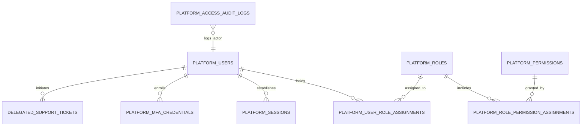
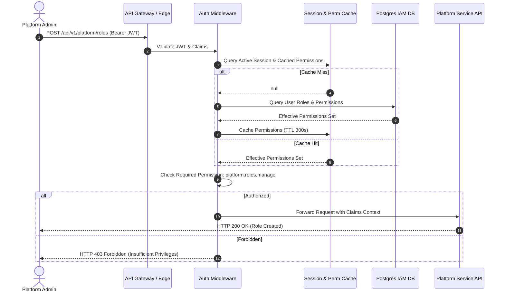

# PHASE E-09.12: BACKEND READINESS & IAM GOVERNANCE SPECIFICATION
## Comprehensive Future Backend Architecture, Identity Provider Integration, Server-Side Authorization, and Access Governance

---

### Purpose & Scope

This specification defines the architectural requirements, relational database schemas, authentication flows, authorization middleware, session revocation mechanics, tamper-evident audit pipelines, and security controls necessary for future backend phases to implement the production identity, access management, and governance engine for the School Management SaaS platform.

> [!IMPORTANT]
> **Strict Non-Implementation Notice:**
> No backend infrastructure, database schema, authentication service, server-side authorization, or production API integration was implemented in Phase E-09.12. This document serves as the authoritative technical contract between the verified Super-Admin frontend workspaces and future backend implementation teams.

---

## 1. Domain Entities & Relational Schema Design

Future backend development must implement the following normalized relational entities (PostgreSQL recommended):



### 1.1 `platform_users`
- **Purpose:** Stores synthetic and verified platform staff identities.
- **Fields:**
  - `id`: UUID (Primary Key, e.g. `uuid_v4`).
  - `email`: VARCHAR(255) UNIQUE NOT NULL.
  - `display_name`: VARCHAR(128) NOT NULL.
  - `status`: ENUM (`invited`, `active`, `suspended`, `deactivated`) NOT NULL DEFAULT `invited`.
  - `department`: VARCHAR(64) NULL.
  - `notes`: TEXT NULL.
  - `idp_subject_id`: VARCHAR(255) UNIQUE NULL (Foreign subject identifier from external OIDC provider).
  - `mfa_enforced`: BOOLEAN NOT NULL DEFAULT true.
  - `mfa_registered`: BOOLEAN NOT NULL DEFAULT false.
  - `created_at`: TIMESTAMPTZ NOT NULL DEFAULT NOW().
  - `updated_at`: TIMESTAMPTZ NOT NULL DEFAULT NOW().
  - `last_authenticated_at`: TIMESTAMPTZ NULL.
  - `deactivated_at`: TIMESTAMPTZ NULL.

### 1.2 `platform_roles`
- **Purpose:** Stores system-managed and custom-authored role definitions.
- **Fields:**
  - `id`: VARCHAR(64) (Primary Key slug, e.g. `super_admin`, `platform_operator`, `custom_auditor`).
  - `name`: VARCHAR(128) NOT NULL.
  - `description`: TEXT NOT NULL.
  - `category`: ENUM (`system`, `custom`) NOT NULL DEFAULT `custom`.
  - `is_privileged`: BOOLEAN NOT NULL DEFAULT false.
  - `is_system_managed`: BOOLEAN NOT NULL DEFAULT false.
  - `created_by`: UUID NULL REFERENCES `platform_users`(id).
  - `created_at`: TIMESTAMPTZ NOT NULL DEFAULT NOW().
  - `updated_at`: TIMESTAMPTZ NOT NULL DEFAULT NOW().

### 1.3 `platform_permissions`
- **Purpose:** Immutable platform capability registry (pre-seeded during deployment).
- **Fields:**
  - `id`: VARCHAR(64) (Primary Key dot-notation slug, e.g. `platform.users.manage`).
  - `label`: VARCHAR(128) NOT NULL.
  - `domain`: VARCHAR(64) NOT NULL.
  - `action`: ENUM (`read`, `create`, `update`, `manage`, `export`, `delete`, `approve`) NOT NULL.
  - `description`: TEXT NOT NULL.
  - `risk_level`: ENUM (`low`, `moderate`, `high`, `critical`) NOT NULL.
  - `is_privileged`: BOOLEAN NOT NULL DEFAULT false.
  - `created_at`: TIMESTAMPTZ NOT NULL DEFAULT NOW().

### 1.4 `platform_role_permission_assignments`
- **Purpose:** Junction table linking roles to granted permissions.
- **Fields:**
  - `role_id`: VARCHAR(64) REFERENCES `platform_roles`(id) ON DELETE CASCADE.
  - `permission_id`: VARCHAR(64) REFERENCES `platform_permissions`(id) ON DELETE RESTRICT.
  - `granted_at`: TIMESTAMPTZ NOT NULL DEFAULT NOW().
  - `PRIMARY KEY (role_id, permission_id)`.

### 1.5 `platform_user_role_assignments`
- **Purpose:** Junction table assigning platform roles to users.
- **Fields:**
  - `user_id`: UUID REFERENCES `platform_users`(id) ON DELETE CASCADE.
  - `role_id`: VARCHAR(64) REFERENCES `platform_roles`(id) ON DELETE RESTRICT.
  - `assigned_by`: UUID REFERENCES `platform_users`(id).
  - `assigned_at`: TIMESTAMPTZ NOT NULL DEFAULT NOW().
  - `PRIMARY KEY (user_id, role_id)`.

---

## 2. Authentication & Identity Provider (IdP) Architecture

### 2.1 Enterprise OIDC / SAML 2.0 Integration
- **Identity Realm Separation:** Platform Super-Administrators must authenticate against an isolated internal corporate realm (e.g. Okta, Azure AD / Microsoft Entra, Google Workspace, or Keycloak).
- **Protocol:** OpenID Connect Authorization Code Flow with PKCE (Proof Key for Code Exchange).
- **Token Claims Validation:**
  - The backend token verifier must validate:
    1. Issuer (`iss` matching internal IdP URL).
    2. Audience (`aud` matching Super-Admin client ID).
    3. Expiration (`exp` strictly enforced, maximum token lifetime 15 minutes).
    4. Signature via IdP JWKS endpoint (`/.well-known/jwks.json`).
    5. Tenant Isolation: Rejection of tokens originating from student, teacher, or school tenant user pools.

### 2.2 Mandatory Multi-Factor Authentication (MFA)
- **FIDO2 / WebAuthn:** Platform Super-Admins and Privileged Operators must require hardware security keys (e.g. YubiKey) or biometric authenticators (Touch ID, Windows Hello).
- **Fallback TOTP:** RFC 6238 Time-Based One-Time Passwords with encrypted seed storage (AES-256-GCM).
- **Privilege Step-Up Authentication:** High-risk actions (e.g. modifying system roles, revoking `super_admin`, initiating tenant data recovery) must require re-authentication (MFA challenge within the last 5 minutes).

### 2.3 Session Management & Instant Revocation
- **Stateless Tokens vs Stateful Cache:** While APIs use short-lived JWTs (15 min), active session tokens must reference a stateful session ID stored in Redis.
- **Instant Revocation Mechanism:**
  - Changing a user's role or status immediately publishes an invalidation event to Redis Pub/Sub.
  - API Gateway and middleware check `redis.get(session_id:revoked)`.
  - Next API request from revoked session returns `HTTP 401 Unauthorized` with `code: SESSION_REVOKED`.

---

## 3. Server-Side Authorization & RBAC Evaluation Engine

### 3.1 Middleware Authorization Flow
Frontend permission checks are purely informational. Every backend API endpoint must pass through a strict authorization middleware:



### 3.2 Evaluation Precedence & Deny Semantics
1. **Disabled/Suspended Status Check:** If `user.status != 'active'`, immediately return `HTTP 403 Account Inactive`.
2. **Wildcard Check:** If user holds `super_admin`, permit all actions except those violating platform invariants.
3. **Explicit Permissions Set:** Union of all permissions attached to active assigned roles.
4. **Deny Default:** Any capability not explicitly present in the resolved set is rejected with `HTTP 403 Forbidden`.

---

## 4. Invariant Rules & Privileged-Role Safeguards

The future backend must enforce these transactional invariants within ACID database transactions:

### 4.1 Sole Active Super-Admin Protection
```sql
-- Transactional Check before updating role assignments or deactivating users
SELECT COUNT(*) INTO active_super_admins
FROM platform_user_role_assignments pura
JOIN platform_users pu ON pura.user_id = pu.id
WHERE pura.role_id = 'super_admin'
  AND pu.status = 'active'
  AND pu.id != target_user_id;

IF active_super_admins = 0 THEN
    RAISE EXCEPTION 'CANNOT_REVOKE_SOLE_SUPER_ADMIN: Operation would leave the platform with 0 active Super-Administrators.';
END IF;
```

### 4.2 System-Managed Role Immutability
```sql
-- Trigger preventing UPDATE or DELETE on system roles
CREATE OR REPLACE FUNCTION protect_system_roles()
RETURNS TRIGGER AS $$
BEGIN
    IF OLD.is_system_managed = true THEN
        RAISE EXCEPTION 'SYSTEM_ROLE_IMMUTABLE: Built-in system roles cannot be modified or deleted.';
    END IF;
    RETURN OLD;
END;
$$ LANGUAGE plpgsql;
```

### 4.3 Concurrent Administrative Changes
- Implement Optimistic Concurrency Control (OCC) using an `etag` or `version_stamp` column on `platform_roles` and `platform_users`.
- Rejects conflicting concurrent writes with `HTTP 409 Conflict`.

---

## 5. Platform Control Plane vs. Tenant Data Plane Isolation

### 5.1 Zero Cross-Tenant Leakage Guarantee
- **Database Architecture:** Logical multi-tenancy with PostgreSQL Row Level Security (RLS) or separate tenant schema/database per enterprise school.
- **Tenant Context Stripping:** Platform administrator session tokens must NEVER contain `tenant_id` claims. An API request with a platform token calling a tenant-scoped route (`/api/v1/tenant/*`) must be rejected at the API gateway.

### 5.2 Delegated Support Protocol (Just-In-Time Access)
When a platform engineer must assist a school tenant with diagnostics:
1. **Consent Ticket Creation:** School Principal submits ticket in `tenant-dashboard/` granting support access for a specified issue.
2. **Time-Bounded Scope:** Support token generated with maximum 60-minute TTL.
3. **Dual Audit Logging:**
   - Logged in Platform Audit Log (`actor: usr_support, action: tenant.impersonate.begin, tenant: org_001`).
   - Logged in Tenant School Log (`event: EXTERNAL_SUPPORT_SESSION_ACTIVE, authorized_by: principal_jane`).
4. **Data Minimization:** Student PII (medical records, grades, guardian phone numbers) must be masked in platform support tools unless explicitly unmasked by tenant principal override.

---

## 6. Audit Logging & Non-Repudiation

### 6.1 Tamper-Evident Audit Event Model
All administrative access events must be written synchronously to an append-only audit stream:

```json
{
  "eventId": "evt_998124_iam",
  "timestamp": "2026-10-18T14:30:00.124Z",
  "actor": {
    "id": "usr_admin_1",
    "name": "Alice Chen",
    "email": "alice.chen@saas-platform.internal",
    "role": "super_admin",
    "ipAddress": "198.51.100.42",
    "userAgent": "Mozilla/5.0 (Macintosh; Intel Mac OS X 10_15_7)..."
  },
  "action": "role.permissions.updated",
  "targetEntity": "platform_role",
  "targetId": "custom_campus_lead",
  "changes": {
    "addedPermissions": ["billing.plans.view"],
    "removedPermissions": []
  },
  "status": "success",
  "hashChain": "e3b0c44298fc1c149afbf4c8996fb92427ae41e4649b934ca495991b7852b855"
}
```

### 6.2 Audit Security Guarantees
1. **Append-Only Storage:** Database table has `REVOKE UPDATE, DELETE ON platform_access_audit_logs FROM platform_service;`.
2. **Cryptographic Hash Chaining:** Each record includes `SHA-256(previous_hash + current_event_payload)` to detect post-hoc database tampering.
3. **Retention & Archival:** Hot storage in PostgreSQL for 180 days; compressed and replicated to WORM (Write Once, Read Many) cloud storage for 7 years to meet compliance standards (SOC 2, ISO 27001, FERPA).

---

## 7. Operational Recovery & Disaster Governance

1. **Break-Glass Root Recovery:** An offline, encrypted emergency key stored in an enterprise hardware vault (e.g. AWS KMS / HashiCorp Vault with multi-party quorum) to recover access if all active super-admins are incapacitated.
2. **Automated IAM Anomaly Detection:** Real-time SIEM alerts triggered when:
   - Multiple privileged role assignments occur within a 5-minute window.
   - Administrative login occurs from an unrecognized geographic region.
   - More than 3 failed MFA challenges occur on a super-admin account.

---

## 8. Explicit Non-Implementation Confirmation

> [!IMPORTANT]
> **Summary Statement:**
> No backend infrastructure, database schema, authentication service, server-side authorization, or production API integration was implemented in Phase E-09.12. All work is strictly frontend demonstration code confined to `dashboard/`. `tenant-dashboard/` remains 100% untouched.
