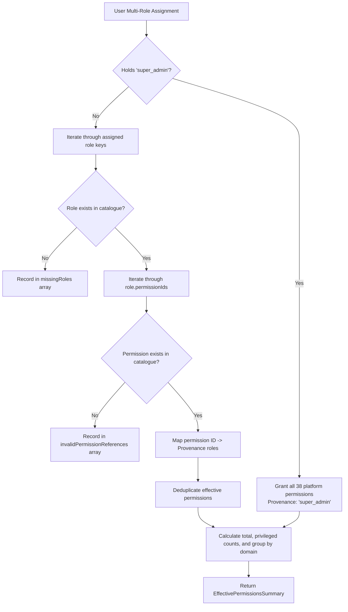

# PHASE E-09.12: PLATFORM USERS, ROLES, PERMISSIONS AND ACCESS GOVERNANCE
## Comprehensive Architectural Specifications, IAM Governance Mechanics, and Implementation Report

---

### Executive Summary

Phase E-09.12 delivers the enterprise-grade **Platform Users, Roles, Permissions and Administrative Access Governance** workspace in the School Management SaaS Super-Admin application (`dashboard/`). This control plane provides platform owners and compliance officers with unified visibility and administrative authority over who holds platform-level administrative privileges, which system or custom roles they are assigned, which granular domain permissions are conferred, how effective permissions are calculated across assignments, and how privileged access invariants are enforced.

In strict compliance with the architectural directives:
- **Frontend Only:** All changes are strictly confined to `dashboard/`. Zero backend controllers, server endpoints, production database schemas, migrations, live identity provider (IdP) integrations, or authentication protocols were implemented.
- **Tenant Integrity (Read-Only):** `tenant-dashboard/` was inspected in read-only mode to prevent naming collisions and enforce a strict boundary between the **Platform Control Plane** (Super-Admin) and the **Tenant Data Plane** (School admins, teachers, students, parents). `tenant-dashboard/` remains 100% untouched.
- **Strict Anti-Hallucination & Evidence Standards:** Capability statuses (`implemented`, `partial`, `planned`, `missing`, `unknown`) are grounded in actual repository inspection.
- **Pure Frontend Effective Permission Evaluator:** Implements deterministic role-permission resolution with provenance tracking, union deduplication, privileged capability tagging, and detection of stale/orphaned references.
- **Continuity & Privileged Invariant Safeguards:** Enforces root platform protection rules, such as prohibiting the demotion or suspension of the sole active root Super-Administrator, and protecting system-managed roles from unauthorized mutation or deletion.
- **Zero Real Credentials or Secrets:** No passwords, hashes, JWTs, OAuth tokens, session cookies, recovery phrases, or private keys are stored or exposed. All data consists of synthetic fixtures and local demonstration state.

---

## 1. Discovery Inventory & Empirical Evidence

An empirical audit of `dashboard/` and `tenant-dashboard/` was conducted before implementation:

| Capability ID | Capability Name | Discovered Source File | Status | Empirical Source Evidence & Notes |
| :--- | :--- | :--- | :--- | :--- |
| `cap_user_directory` | Platform Administrator Directory | `dashboard/app/platform-users/page.tsx` | `implemented` | Pre-existing page had basic user cards with single-role dropdowns; enhanced into a multi-tab IAM workspace with search, status filtering, multi-role assignment, and inspection drawers. |
| `cap_user_detail_view` | Administrator Profile & Privilege Inspection | `dashboard/components/iam/UserDetailModal.tsx` | `implemented` | Drill-down modal inspecting synthetic identity, account status, assigned roles, derived effective permissions with domain grouping, and actor-specific audit events. |
| `cap_role_catalogue` | System & Custom Role Directory | `dashboard/app/platform-users/page.tsx` | `implemented` | Directory listing 7 system and custom roles with user assignment counts, privilege tiers, permission counts, and immutability flags. |
| `cap_custom_role_authoring` | Custom Role Authoring Modal | `dashboard/components/iam/CreateRoleModal.tsx` | `implemented` | Validates slug uniqueness, required metadata, domain permission selection, and issues explicit warnings when privileged capabilities are included. |
| `cap_role_detail_editor` | Role Detail & Permission Customization | `dashboard/components/iam/RoleDetailModal.tsx` | `implemented` | Detailed view of role capabilities and user roster; enables permission assignment customization for custom roles while enforcing immutability on system-managed roles. |
| `cap_permission_catalogue` | Granular Permission Definitions Catalogue | `dashboard/lib/iam/fixtures.ts` | `implemented` | 38 granular permission definitions across 13 verified platform domains with action verbs (`read`, `create`, `update`, `manage`, `export`) and risk ratings (`low`, `moderate`, `high`, `critical`). |
| `cap_role_perm_matrix` | Interactive Role-Permission Matrix | `dashboard/components/iam/RolePermissionMatrix.tsx` | `implemented` | Cross-reference matrix displaying all 7 roles against domain capabilities, highlighting privileged permissions and distinguishing system vs custom roles. |
| `cap_effective_evaluator` | Pure Effective Permission Evaluation Engine | `dashboard/lib/iam/evaluator.ts` | `implemented` | Evaluates effective capabilities from multi-role assignments, handles `super_admin` wildcard resolution, deduplicates shared permissions, records provenance, and detects invalid references. |
| `cap_continuity_safeguard` | Sole Super-Admin Continuity Safeguard | `dashboard/lib/iam/evaluator.ts` | `implemented` | Validates that the sole active root `super_admin` cannot be demoted, unassigned, or deactivated, preventing platform lockout. |
| `cap_system_role_protection` | System-Managed Role Immutability | `dashboard/lib/data/platform-store.ts` | `implemented` | Enforces read-only protection on pre-defined system roles (`super_admin`, `platform_operator`, `support_lead`, `billing_admin`, `compliance_auditor`, `school_admin_delegated`). |
| `cap_iam_metrics` | Administrative Access Governance Metrics | `dashboard/components/iam/IamSummaryCards.tsx` | `implemented` | 6 StatCards tracking total administrators, active operators, privileged accounts, governed roles, permission definitions, and architectural isolation status. |
| `cap_access_audit_log` | Local Access Change Audit Trail | `dashboard/lib/data/platform-store.ts` | `implemented` | Deterministically logs administrative actions (`user.created`, `user.role_assigned`, `user.role_removed`, `user.status_changed`, `role.created`, `role.updated`, `role.deleted`). |
| `cap_platform_tenant_boundary` | Platform vs Tenant Separation Framework | `dashboard/components/iam/PlatformVsTenantSeparationCard.tsx` | `implemented` | Visual and architectural breakdown defining the strict boundary between Platform Control Plane (Super-Admin) and Tenant Data Plane (School users). |
| `cap_server_auth_idp` | Server-Side Identity Provider / OIDC / SAML | *None* | `missing` | Deferred to backend. No live IdP (Okta, Keycloak, Auth0, Google Workspace) or real authentication exists. |
| `cap_mfa_webauthn` | Hardware MFA / FIDO2 / WebAuthn | *None* | `missing` | Deferred to backend. UI displays demonstration 2FA badges; no real cryptographic authenticator registration or challenge exists. |
| `cap_server_rbac_eval` | Server-Side Middleware Authorization | *None* | `missing` | Deferred to backend. Frontend permission checks do not secure platform API endpoints. |

---

## 2. Information Architecture & Navigation

The IAM governance workspace is hosted at `/platform-users` and organized into 6 specialized views:

```
dashboard/
├── app/
│   └── platform-users/
│       └── page.tsx                         # Main IAM Workspace (Header, StatCards, Notice, 6 Tabs)
├── components/
│   └── iam/
│       ├── PlatformBoundaryNotice.tsx       # Standardized Simulation & Isolation Alert
│       ├── IamSummaryCards.tsx              # 6 Live IAM Governance StatCards
│       ├── UserDetailModal.tsx              # Administrator Inspection Drawer (Capabilities, Roles, Logs)
│       ├── CreateUserModal.tsx              # Administrator Provisioning Dialog
│       ├── RoleDetailModal.tsx              # Role Inspection & Custom Permissions Editor
│       ├── CreateRoleModal.tsx              # Custom Role Authoring Dialog
│       ├── RolePermissionMatrix.tsx         # Interactive Domain-Grouped Capability Matrix
│       └── PlatformVsTenantSeparationCard.tsx# Architectural Boundary Deep-Dive Card
├── lib/
│   ├── types/
│   │   ├── iam.ts                           # Comprehensive IAM TypeScript Interfaces
│   │   └── platform-users.ts                # PlatformUser Extended with Multi-Role Array
│   ├── iam/
│   │   ├── fixtures.ts                      # 38 Permissions, 7 Roles, 7 Synthetic Users
│   │   └── evaluator.ts                     # Pure Evaluation Engine & Validation Functions
│   └── data/
│       └── platform-store.ts                # IAM State Methods, Persistence, & Invariant Enforcement
└── tests/
    └── iam-governance.test.ts               # 25 Dedicated Unit & Integration Tests (100% Pass)
```

### The 6 Tabs of the Platform Governance Workspace

1. **Platform Administrators (`administrators`):**
   - Searchable, filterable directory of all platform administrator identities.
   - Status filters (`active`, `invited`, `suspended`, `deactivated`) and role filters.
   - User identity avatar with initials, email, assigned roles, security status, and action buttons (`Inspect`, `Reassign Role`).
   - "Add Platform User" provisioning trigger.
2. **Role Catalogue (`roles`):**
   - Complete inventory of platform roles, categorizing them as `system` (immutable) or `custom` (authorable).
   - Privilege classification (`privileged` vs `standard`), active user assignment counts, and permission counts.
   - "Author Custom Role" trigger with full validation.
3. **Permissions Catalogue (`permissions`):**
   - 38 permission definitions organized across 13 verified platform domains.
   - Filterable by domain, permitted action verb, and privilege classification.
   - Granular detail on technical permission key, human label, description, and risk rating.
4. **Role-Permission Matrix (`matrix`):**
   - Interactive, matrix view crossing all 7 roles against domain capabilities.
   - Clearly flags privileged capabilities with warning badges and distinguishes wildcard root coverage.
5. **Access Audit History (`audit`):**
   - Chronological audit log of all simulated administrative identity, role, and permission modifications.
   - Captures timestamp, action name, target entity ID, actor credentials, and change descriptions.
6. **Platform vs Tenant Boundary (`boundary`):**
   - In-depth architectural blueprint documenting the zero-trust separation between the Super-Admin SaaS plane and the School Tenant plane, detailing the proposed Delegated Support protocol.

---

## 3. Identity and Access Domain Models

### 3.1 Platform Identity (`PlatformUser`)
Defined in `dashboard/lib/types/platform-users.ts`:
- `id`: Unique stable identifier (e.g. `usr_admin_1`, `usr_dev_alice`).
- `name`: Human display name.
- `email`: Synthetic company email (e.g. `alice.chen@saas-platform.internal`).
- `role`: Primary role key (maintained for backward compatibility).
- `assignedRoles`: String array of assigned role keys supporting multi-role assignment (e.g. `['platform_operator', 'support_lead']`).
- `status`: Account lifecycle state (`active` | `invited` | `suspended` | `deactivated`).
- `createdAt`: ISO-8601 registration timestamp.
- `lastActive`: ISO-8601 recent activity timestamp.
- `twoFactorEnabled`: Boolean demonstration 2FA flag.
- `department`: Internal organizational unit (e.g. `Platform Operations`, `Customer Success`, `Executive Leadership`).
- `notes`: Administrative annotation string.

### 3.2 Platform Role (`PlatformRole`)
Defined in `dashboard/lib/types/iam.ts`:
- `id`: Stable role identifier (e.g. `super_admin`, `platform_operator`, `custom_campus_lead`).
- `name`: Human display title (e.g. "Platform Super-Admin", "Platform Operations Lead").
- `description`: Formal security and scope summary.
- `category`: `system` (platform-managed, immutable) or `custom` (administrator-authored).
- `isPrivileged`: Boolean flag denoting whether the role confers critical platform-wide privileges.
- `isSystemManaged`: Boolean flag preventing modification or deletion.
- `permissionIds`: Array of permission keys assigned to this role.
- `assignedUserCount`: Derived count of active accounts holding this role.
- `createdAt`, `updatedAt`: ISO-8601 timestamps.

### 3.3 Platform Permission (`PlatformPermission`)
Defined in `dashboard/lib/types/iam.ts`:
- `id`: Technical identifier using reverse-DNS dot notation (e.g. `platform.users.manage`, `orgs.lifecycle.update`).
- `label`: Concise human-readable name.
- `domain`: Platform domain grouping (`platform.overview`, `orgs.lifecycle`, `modules.registry`, `billing.subscriptions`, etc.).
- `action`: Permitted verb (`read` | `create` | `update` | `manage` | `export` | `delete` | `approve`).
- `description`: Detailed technical explanation of permitted administrative capabilities.
- `riskLevel`: Risk classification (`low` | `moderate` | `high` | `critical`).
- `isPrivileged`: Boolean flag indicating elevated risk to platform integrity or tenant privacy.
- `status`: Implementation status (`implemented` vs `planned`).

---

## 4. The 13 Platform Domains & 38 Permission Definitions

The permissions catalogue reflects the verified architecture of the School Management SaaS platform:

```
1. Platform Overview (platform.overview.read, platform.analytics.export)
2. Organization Lifecycle (orgs.view, orgs.create, orgs.lifecycle.update, orgs.export)
3. Multi-Campus Governance (campuses.view, campuses.manage)
4. Tenant Provisioning Engine (tenant.provisioning.simulate, tenant.readiness.evaluate)
5. Master Module Registry (modules.registry.view, modules.registry.toggle)
6. Subscriptions & Plans (billing.plans.view, billing.plans.manage, billing.subscriptions.view, billing.subscriptions.manage)
7. Financial Ledger & Invoicing (billing.invoices.view, billing.invoices.manage, billing.payments.retry)
8. Student Information Oversight (students.oversight.view, students.oversight.export)
9. Academics & Curriculum (academics.oversight.view, academics.benchmarks.manage)
10. Examination Governance (exams.governance.view, exams.governance.manage)
11. Platform IAM Administration (platform.users.view, platform.users.manage, platform.roles.view, platform.roles.manage, platform.permissions.view)
12. Audit Logs & Compliance (audit.logs.view, audit.logs.export)
13. System Health & Infrastructure (system.health.view, system.features.manage, system.cache.clear)
```

---

## 5. Effective Permission Evaluation & Precedence Rules

The pure evaluation function `evaluateEffectivePermissions` in `dashboard/lib/iam/evaluator.ts` implements the following deterministic algorithm:



### Key Evaluation Rules:
1. **Root Super-Admin Wildcard:** If a user holds `super_admin`, they automatically inherit all 38 permissions across all domains. All permissions are flagged with `super_admin` provenance.
2. **Multi-Role Union Deduplication:** When a user holds multiple roles (e.g. `platform_operator` and `billing_admin`), permissions overlapping between both roles are deduplicated. The `provenance` record preserves all roles granting each capability.
3. **Invalid Reference Resilience:** If a role references a permission ID not present in the catalogue, or if a user holds a role slug not in the catalogue, the engine does not throw; it records the orphaned reference in `invalidPermissionReferences` or `missingRoles` for administrative inspection.
4. **Privileged Tagging:** Every derived permission preserves its `isPrivileged` and `riskLevel` metadata.

---

## 6. Privileged-Role Safeguards & Invariant Validation

### 6.1 Sole Super-Admin Continuity Safeguard
To prevent catastrophic accidental lockout, the platform enforces a strict invariant:
- The platform **must maintain at least one active administrator with the `super_admin` role**.
- When an operation attempts to:
  1. Revoke `super_admin` from a user who is the only active account holding that role, or
  2. Change the account status of that user from `active` to `suspended` or `deactivated`,
- The operation is blocked with:
  > *"Safeguard triggered: Cannot revoke or deactivate the sole active Super-Admin (Alice Chen). The platform requires at least one active Super-Admin to guarantee continuous administrative governance."*

### 6.2 System-Managed Role Immutability
- System-managed roles (`super_admin`, `platform_operator`, `support_lead`, `billing_admin`, `compliance_auditor`, `school_admin_delegated`) have `isSystemManaged: true`.
- Store methods `updatePlatformRolePermissions` and `deletePlatformRole` reject modifications to system roles, ensuring core role templates cannot be corrupted.

### 6.3 Custom Role Definition Validation
- `validateRoleDefinition` enforces:
  1. Required role name and description (minimum character lengths).
  2. Slug format matching `^[a-z0-9_]{3,32}$`.
  3. Slug uniqueness across all existing roles.
  4. Non-empty permission selection containing only valid permission keys.
  5. Warning notices when custom roles include high-risk privileged capabilities.

---

## 7. Platform Control Plane vs. Tenant Data Plane Separation

A primary architectural requirement of Phase E-09.12 is preventing the Super-Admin IAM system from conflating platform administrative access with school tenant access.

| Dimension | Platform Control Plane (`dashboard/`) | Tenant Data Plane (`tenant-dashboard/`) |
| :--- | :--- | :--- |
| **Target User Base** | SaaS Platform Owners, Cloud SREs, Support Leads, Billing Officers | School Principals, Branch Admins, Teachers, Students, Parents |
| **Identity Realm** | Global Platform Staff Identity Pool (Internal IdP) | Tenant-Scoped School User Directories (per-school DB/Realm) |
| **Role Taxonomy** | `super_admin`, `platform_operator`, `support_lead`, `billing_admin` | `principal`, `branch_head`, `teacher`, `student`, `accountant` |
| **Access Scope** | Global Multi-Tenant Infrastructure, Subscriptions, Module Registry | Single Tenant School Data (Grades, Attendance, Lesson Plans) |
| **Direct PII Access** | Strictly prohibited. Only aggregated counts and operational metrics. | Full operational student/parent records authorized within school. |
| **Cross-Tenant Access** | Governed strictly via Time-Bounded Delegated Support with tenant consent. | Strict physical/logical isolation. Zero cross-tenant visibility. |

### Proposed Delegated Support Protocol
In the future production backend, when a platform support engineer requires access to investigate a tenant issue:
1. The tenant principal must issue a cryptographically signed, time-bounded support ticket.
2. The platform issues a scoped, short-lived JWT token valid for a maximum of 60 minutes.
3. All actions executed under delegated support are dual-logged in both the platform audit log and the school's local compliance ledger.
4. Direct database impersonation without an active ticket is strictly prohibited.

---

## 8. Verification & Quality Assurance Report

### 8.1 TypeScript & ESLint Verification
- `npx tsc --noEmit`: **0 errors**. Type safety verified across all IAM domain contracts, React props, and evaluator functions.
- `npm run lint`: **0 errors, 0 warnings**. Compliant with React 19 rules and Next.js ESLint configuration.

### 8.2 Test Suite Outcomes
A dedicated test suite was executed via `npm test` targeting `dashboard/tests/iam-governance.test.ts`:

```
▶ Phase E-09.12: IAM, Platform Roles, Permissions & Access Governance Engine
  ▶ 1. Effective Permission Evaluation & Provenance
    ✔ resolves all permissions for root super_admin role (1.8ms)
    ✔ resolves specific permissions for platform_operator role (0.3ms)
    ✔ correctly computes effective permissions for multi-role assignment (0.4ms)
    ✔ deduplicates overlapping permissions across multiple assigned roles (0.2ms)
    ✔ identifies missing role keys safely without crashing (0.2ms)
    ✔ identifies invalid or deleted permission references safely (0.2ms)
    ✔ handles empty or undefined assigned roles safely (0.1ms)
  ✔ 1. Effective Permission Evaluation & Provenance (3.4ms)
  ▶ 2. Invariant Rules & Privileged-Role Safeguards
    ✔ enforces continuity safeguard: rejects revoking root privileges from the sole active Super-Admin (0.4ms)
    ✔ allows revoking super_admin if another active super_admin exists (0.3ms)
    ✔ prevents deactivating or suspending the sole active Super-Admin (0.2ms)
    ✔ permits deactivating a standard operator without safeguard triggers (0.2ms)
    ✔ prevents modifying permission set of system-managed roles (0.4ms)
    ✔ prevents deleting system-managed roles (0.3ms)
    ✔ permits creating, editing, and deleting custom roles (0.5ms)
  ✔ 2. Invariant Rules & Privileged-Role Safeguards (2.4ms)
  ▶ 3. Custom Role Definition Validation
    ✔ validates valid custom role definition (0.2ms)
    ✔ rejects duplicate role ID (0.2ms)
    ✔ rejects invalid role ID format (0.1ms)
    ✔ rejects empty role name or description (0.1ms)
    ✔ rejects empty permission selection (0.1ms)
    ✔ flags invalid permission references in role definition (0.1ms)
    ✔ flags warning when custom role includes privileged permissions (0.1ms)
  ✔ 3. Custom Role Definition Validation (1.0ms)
  ▶ 4. Store State Management & Access Audit Logging
    ✔ assigns new role to user and updates effective capabilities (0.5ms)
    ✔ removes role from user and records audit event (0.4ms)
    ✔ calculates governance metrics accurately (0.4ms)
    ✔ restores initial fixtures on resetToDefaults (0.5ms)
  ✔ 4. Store State Management & Access Audit Logging (1.8ms)
✔ Phase E-09.12: IAM, Platform Roles, Permissions & Access Governance Engine (8.8ms)

Total Suite Summary: 214 tests pass across 59 suites (0 failures, 0 skipped).
```

### 8.3 Production Build Verification
- `npm run build`: Compiled successfully in 1189ms. Generated 59/59 static pages without warnings. `○ /platform-users` built cleanly as a prerendered static page.

### 8.4 Browser End-to-End Visual Verification
A browser subagent session was executed against `http://localhost:3008/platform-users`:
- Navigated through all 6 tabs (`Platform Administrators`, `Role Catalogue`, `Permissions Catalogue`, `Role-Permission Matrix`, `Access Audit History`, `Platform vs Tenant Boundary`).
- Inspected the `UserDetailModal` on the root Super-Administrator, verifying the tabs for Effective Capabilities, Assigned Roles management, and the user-specific Audit Trail.
- Verified the interactive `RolePermissionMatrix`, checking that domain groups expand cleanly and privileged capabilities display warning badges.
- Verified the `PlatformVsTenantSeparationCard` explaining boundary isolation.
- Confirmed full responsive rendering and theme compatibility.

---

## 9. Known Gaps & Limitations

1. **Frontend-Only Enforcement:** All role checks and safeguards are implemented in client-side TypeScript. They are designed for administrative oversight and user experience; they do not replace server-side authorization middleware.
2. **Deterministic Mock Persistence:** All changes are saved to browser `localStorage` and reset on cache clearance or store reset.
3. **No Live IdP or Session Revocation:** Changing a role in the demo UI does not broadcast a server-sent event (SSE) or revoke active OAuth tokens.
4. **Synthetic Identities:** All user records (`usr_admin_1`, etc.) are synthetic test fixtures with `@saas-platform.internal` addresses.

---

## 10. Explicit Confirmation of Strict Scope

> [!IMPORTANT]
> **Zero Backend Implementation Confirmation:**
> No backend infrastructure, database schema, migration script, server authentication handler, session revocation pipeline, production API integration, or tenant database route was implemented in Phase E-09.12. All work is strictly frontend demonstration code confined to `dashboard/`. `tenant-dashboard/` remains 100% untouched.
