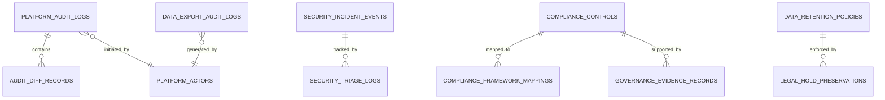

# PHASE E-09.13: BACKEND READINESS & COMPLIANCE GOVERNANCE SPECIFICATION
## Comprehensive Specifications for Immutable Audit Logging, SIEM Ingestion, Compliance Evidence Storage, and Statutory Retention Engines

---

### Purpose & Scope

This specification defines the backend architectural requirements, relational database schemas, cryptographic hash-chaining protocols, SIEM telemetry pipelines, automated retention enforcement daemons, and export authorization mechanisms necessary for future backend phases to implement an enterprise-grade platform audit trail and compliance governance engine for the School Management SaaS platform.

> [!IMPORTANT]
> **Strict Non-Implementation Notice:**
> No backend infrastructure, database schema, server endpoint, real-time security-monitoring integration, or production compliance integration was implemented in Phase E-09.13. This document serves as the authoritative technical specification and contract between the verified Super-Admin frontend governance workspaces and future server-side engineering teams.

---

## 1. Domain Entities & Relational Schema Architecture

Future backend development must implement the following normalized relational entities (PostgreSQL recommended):

### 1.1 `platform_audit_logs`
- **Purpose:** Authoritative, tamper-evident log of all Super-Admin state mutations, administrative workflows, and system events.
- **Fields:**
  - `id`: UUID (Primary Key, e.g. `uuid_v7` for chronological sorting).
  - `timestamp`: TIMESTAMPTZ NOT NULL DEFAULT CLOCK_TIMESTAMP().
  - `category`: VARCHAR(64) NOT NULL (e.g. `iam_access_control`, `organization_lifecycle`, `subscription_billing`).
  - `action`: VARCHAR(128) NOT NULL (e.g. `ORGANIZATION_STATUS_SUSPENDED`, `ROLE_PERMISSIONS_UPDATED`).
  - `severity`: VARCHAR(16) NOT NULL CHECK (severity IN ('info', 'warning', 'critical')).
  - `actor_id`: UUID NOT NULL,
  - `actor_type`: VARCHAR(32) NOT NULL (e.g. `super_admin`, `platform_operator`, `system_daemon`).
  - `actor_ip_address`: INET NOT NULL.
  - `actor_user_agent`: TEXT NOT NULL.
  - `target_entity`: VARCHAR(64) NOT NULL (e.g. `Organization`, `PlatformUser`, `Plan`).
  - `target_id`: VARCHAR(128) NOT NULL.
  - `target_name`: VARCHAR(255) NULL.
  - `organization_id`: UUID NULL (Nullable foreign key for tenant-scoped operations).
  - `outcome`: VARCHAR(16) NOT NULL CHECK (outcome IN ('succeeded', 'failed', 'rejected')).
  - `correlation_id`: UUID NOT NULL (Distributed tracing request ID from API Gateway).
  - `details`: TEXT NOT NULL.
  - `metadata_json`: JSONB NULL (Sanitized domain-specific attributes).
  - `previous_record_hash`: BYTEA NOT NULL (Cryptographic SHA-256 hash of previous log record).
  - `current_record_hash`: BYTEA NOT NULL (SHA-256 HMAC of [id, timestamp, actor_id, action, target_id, previous_record_hash]).
  - `created_at`: TIMESTAMPTZ NOT NULL DEFAULT CLOCK_TIMESTAMP().

### 1.2 `audit_diff_records`
- **Purpose:** Normalizes state changes associated with configuration and role updates without storing raw PII or secret tokens.
- **Fields:**
  - `id`: UUID PRIMARY KEY.
  - `audit_log_id`: UUID NOT NULL REFERENCES `platform_audit_logs`(id) ON DELETE CASCADE.
  - `field_path`: VARCHAR(255) NOT NULL (e.g. `role`, `status`, `discountPercentage`).
  - `previous_value_sanitized`: JSONB NULL.
  - `new_value_sanitized`: JSONB NULL.

### 1.3 `security_incident_events` & `security_triage_logs`
- **Purpose:** Stores security-related events ingested from API gateways, rate limiters, or administrative privilege monitors.
- **Fields:**
  - `id`: UUID PRIMARY KEY.
  - `category`: VARCHAR(64) NOT NULL.
  - `severity`: VARCHAR(16) NOT NULL CHECK (severity IN ('info', 'low', 'medium', 'high', 'critical')).
  - `triage_status`: VARCHAR(32) NOT NULL DEFAULT 'unreviewed'.
  - `summary`: TEXT NOT NULL.
  - `suggested_action`: TEXT NOT NULL.
  - `remediation_notes`: TEXT NULL.
  - `remediated_by`: UUID NULL.
  - `remediated_at`: TIMESTAMPTZ NULL.

### 1.4 `data_retention_policies` & `legal_hold_preservations`
- **Purpose:** Governs data life-cycle schedules and active litigation/regulatory preservation locks.
- **Fields:**
  - `id`: VARCHAR(64) PRIMARY KEY.
  - `name`: VARCHAR(128) NOT NULL.
  - `data_category`: VARCHAR(64) NOT NULL UNIQUE.
  - `retention_duration_days`: INTEGER NOT NULL (-1 represents permanent statutory preservation).
  - `is_enabled`: BOOLEAN NOT NULL DEFAULT true.
  - `legal_holds_count`: INTEGER NOT NULL DEFAULT 0.
  - `last_reviewed_at`: TIMESTAMPTZ NOT NULL.
  - `last_reviewed_by`: UUID NOT NULL.
  - `compliance_basis`: TEXT NOT NULL.

---

## 2. Fifteen Future Backend Readiness Specifications

Each of the 15 architectural dimensions specified in prompt Section 16.B is detailed below with explicit technical requirements across data, validation, authorization, retention, and testing implications:

### 1. Trusted Audit-Event Creation
- **Data Implications:** Audit events must originate exclusively from trusted backend middleware or transaction lifecycles, never from untrusted client requests.
- **Validation Implications:** Every emitted event must conform to strict JSON schemas; missing required fields (actor, action, target, outcome) must abort the transaction.
- **Authorization Implications:** Audit emission occurs under system daemon authority within internal microservice contexts.
- **Retention Implications:** Primary audit logs must be immutable upon insertion and preserved for at least 7 years.
- **Testing Implications:** Unit tests must intercept database commit hooks to verify that all mutating state transactions synchronously emit a corresponding audit log record.

### 2. Immutable & Tamper-Evident Audit Storage
- **Data Implications:** Implement a cryptographically linked Merkle tree or hash-chain where each record contains `SHA-256(previous_hash + current_payload)` stored in an append-only relational table. Mirror logs to AWS S3 Object Lock (Write-Once-Read-Many / WORM) or GCP Cloud Storage Bucket Lock.
- **Validation Implications:** Automated cryptographic verification jobs run hourly to assert that no records have been altered, reordered, or deleted.
- **Authorization Implications:** Zero database roles (including DBA and application roles) may hold `UPDATE` or `DELETE` permissions on `platform_audit_logs`.
- **Retention Implications:** Strict WORM compliance mode prevents object deletion even by cloud root administrators before retention expiry.
- **Testing Implications:** Automated tests must attempt SQL `UPDATE` and `DELETE` queries against audit tables and assert that the database engine rejects them with permission errors.

### 3. Actor Identity & Authorization
- **Data Implications:** Every audit event must bind the verified subject claim (`sub`) from the validated JWT/session, alongside caller IP address, user agent, and effective platform role.
- **Validation Implications:** Client-supplied actor labels must be discarded; the server resolves identity strictly from verified session tokens.
- **Authorization Implications:** Only authenticated Super-Admins with `audit:read` permissions may query the audit trail.
- **Retention Implications:** Historical user display names and emails must be preserved in audit snapshots even if the user is subsequently renamed or deleted.
- **Testing Implications:** End-to-end integration tests must verify that spoofing actor headers in API requests is completely ignored by the audit ingestion pipeline.

### 4. Event Integrity & Timestamp Provenance
- **Data Implications:** Timestamps must be generated exclusively by server database clocks (`CLOCK_TIMESTAMP()`) synchronized via Network Time Protocol (NTP) to Stratum-1 time servers.
- **Validation Implications:** Reject any audit event containing a client-asserted timestamp differing by more than 5 seconds from the server gateway clock.
- **Authorization Implications:** Time synchronizer daemon operates in isolated host infrastructure.
- **Retention Implications:** Monotonically increasing microsecond timestamps must be preserved for deterministic log reordering.
- **Testing Implications:** Chaos testing simulating client clock drift must demonstrate zero effect on server audit log ordering.

### 5. Organization & Tenant Scoping
- **Data Implications:** All tenant-specific events must include `organization_id` foreign keys indexed for tenant partition isolation. Platform-wide events (e.g. creating a global subscription plan) record `organization_id = NULL`.
- **Validation Implications:** Tenant organization IDs must resolve to an active organization in the multi-tenant registry.
- **Authorization Implications:** Tenant school administrators can only query audit logs where `organization_id = user.organization_id`. Cross-tenant log access must be rejected with 403 Forbidden.
- **Retention Implications:** Tenant-specific retention schedules can override default schedules if SLA agreements stipulate extended retention.
- **Testing Implications:** Cross-tenant access tests must assert that School A's administrators receive empty results when querying School B's audit events.

### 6. Security Telemetry Ingestion
- **Data Implications:** Ingest security event streams from Cloudflare WAF, AWS GuardDuty, CrowdStrike/Wazuh agents, and API rate limiters into an event bus (Apache Kafka or AWS Kinesis).
- **Validation Implications:** Ingested alerts must be sanitized and classified according to standard Common Event Format (CEF) or Open Cybersecurity Schema Framework (OCSF).
- **Authorization Implications:** SIEM webhooks authenticate via mutual TLS (mTLS) or HMAC request signatures.
- **Retention Implications:** Raw security telemetry is retained for 90 days; classified security incident triage records are retained for 3 years.
- **Testing Implications:** Integration tests simulating brute force or rapid permission escalation must verify automated ingestion into the security triage workspace.

### 7. Alert Classification & Incident Workflows
- **Data Implications:** Incidents must be classified into deterministic severity tiers (`critical`, `high`, `medium`, `low`, `info`) using rule engines (e.g. Sigma rules).
- **Validation Implications:** Escalating an incident requires operator justification notes of at least 20 characters and an assigned lead investigator.
- **Authorization Implications:** Only users holding `security:triage` permission can mutate incident review states.
- **Retention Implications:** Completed incident triage post-mortems must be retained for 3 years to comply with NIST SP 800-61.
- **Testing Implications:** Test suite must assert state machine transitions from `unreviewed` -> `investigating` -> `remediated` or `false_positive`.

### 8. Audit Retention & Legal Holds
- **Data Implications:** Implement automated partition-drop worker daemons scheduled via pg_partman or AWS Glue. Records subject to `active_legal_holds > 0` are excluded from archival/purging.
- **Validation Implications:** Deletion or truncation queries must evaluate active legal holds in a transaction lock.
- **Authorization Implications:** Applying or releasing a legal hold requires dual-authorization (`Four-Eyes Principle`) from Legal Counsel and Lead Compliance Officer.
- **Retention Implications:** Indefinite preservation for student academic records and active litigation items.
- **Testing Implications:** Negative automated tests must verify that automated purge jobs fail to delete records flagged with active legal holds.

### 9. Data Minimization & Sensitive-Field Redaction
- **Data Implications:** Audit logging interceptors must apply zero-knowledge redaction patterns to all payload bodies before persistence.
- **Validation Implications:** Automatic regex scanning for credit card numbers (Luhn check), passwords, JWTs, OAuth bearer tokens, and student health data.
- **Authorization Implications:** Redacted fields (`[REDACTED_SECRET]`) cannot be unmasked by any platform role.
- **Retention Implications:** Redacted entries ensure that long-term audit storage does not create secondary GDPR/FERPA compliance liabilities.
- **Testing Implications:** Automated tests asserting that submitting passwords or credit cards in API requests results in sanitized `[REDACTED]` tokens in audit log metadata.

### 10. Compliance Evidence Storage
- **Data Implications:** Compliance artifacts (SOC 2 audit reports, penetration test certificates, architecture diagrams) must be stored in encrypted object storage (SSE-KMS) with SHA-256 checksums.
- **Validation Implications:** Uploaded evidence must be signed and validated against cryptographic digests.
- **Authorization Implications:** Read access restricted to `compliance_auditor` and `super_admin` roles.
- **Retention Implications:** Evidence documents retained for the duration of the certified compliance cycle plus 3 years.
- **Testing Implications:** Verify that corrupt or mismatched checksum uploads are rejected.

### 11. Policy Versioning & Approvals
- **Data Implications:** Retention policy changes must be versioned (`policy_version_history` table) recording previous retention days, new retention days, and approval signatures.
- **Validation Implications:** Reductions in retention periods require a 30-day pending grace period before enforcement.
- **Authorization Implications:** Requires approval from CISO and Data Protection Officer (DPO).
- **Retention Implications:** Historical policy versions preserved permanently.
- **Testing Implications:** Validate that unapproved policy updates are rejected by API validation middleware.

### 12. Export Authorization & Traceability
- **Data Implications:** All export requests must be processed asynchronously via secure signed URLs with 15-minute expiration.
- **Validation Implications:** Export filters must be validated against allowed user scope.
- **Authorization Implications:** Requires `audit:export` permission. Exports of over 10,000 records trigger an out-of-band security alert to the platform owner.
- **Retention Implications:** Generated export files are purged from object storage after 24 hours; the audit record of the export action is preserved for 7 years.
- **Testing Implications:** Test CSV formula injection neutralization and verify that signed download links expire after timeout.

### 13. Access Logging for Sensitive Administrative Operations
- **Data Implications:** Access to the audit log explorer itself must be recursively audited in a dedicated meta-access log (`meta_audit_access_logs`).
- **Validation Implications:** Every query, filter parameter, and view drawer expansion must be recorded.
- **Authorization Implications:** Meta-access logs can only be viewed by third-party auditors and Chief Compliance Officer.
- **Retention Implications:** 7-year statutory retention.
- **Testing Implications:** Assert that opening the audit explorer generates an internal meta-audit record.

### 14. Monitoring, Backup, Recovery & Operational Resilience
- **Data Implications:** Point-In-Time-Recovery (PITR) enabled with 35-day transaction log retention and cross-region replication (e.g. AWS us-east-1 to us-west-2).
- **Validation Implications:** Automated daily backup restoration verification in an isolated staging sandbox.
- **Authorization Implications:** Disaster recovery restoration restricted to Cloud Infrastructure SREs.
- **Retention Implications:** Daily backups retained for 30 days, monthly backups retained for 1 year, annual snapshots retained for 7 years.
- **Testing Implications:** Disaster recovery drill simulating database node loss and asserting zero data loss (RPO = 0, RTO < 15 minutes).

### 15. Error Handling & Audit-Write Failure Behavior
- **Data Implications:** The platform must implement a "Fail-Secure" (Fail-Closed) architectural policy for privileged administrative operations. If the audit logging pipeline fails to persist an event, the parent business transaction MUST roll back.
- **Validation Implications:** Catch and escalate audit write timeouts or database disk space exhaustion.
- **Authorization Implications:** System daemon monitoring pipeline health.
- **Retention Implications:** Transient audit write errors queue into an emergency local disk spool buffer.
- **Testing Implications:** Chaos injection simulating audit database outage during a role assignment must verify that the role assignment transaction aborts and returns 500 Server Error without persisting un-audited state mutations.

---

## 3. Explicit Non-Implementation Statement

**No backend infrastructure, database schema, server endpoint, real-time security-monitoring integration, or production compliance integration was implemented in this phase.**
