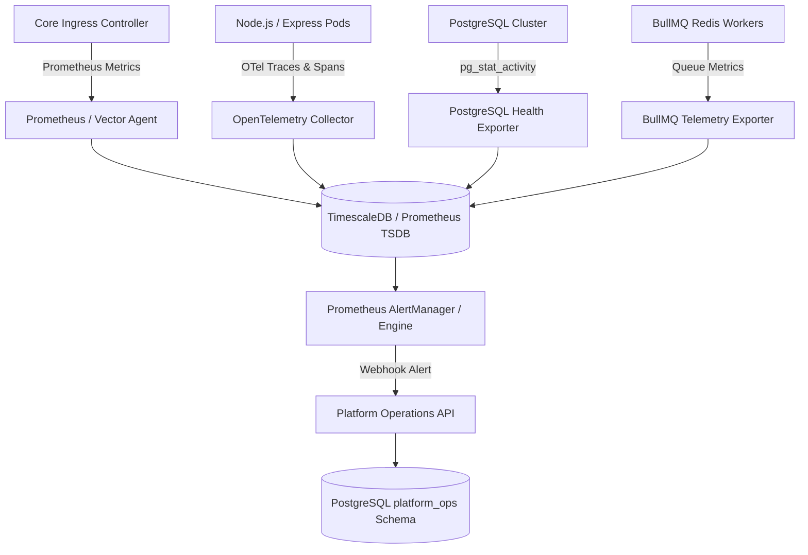

# E-09.14: Backend Readiness Specification
## System Health, Observability and Platform Operations Governance

> [!IMPORTANT]
> **Status:** Architecture Specification — Not Yet Implemented.
> In accordance with project rule 1.1, the backend has not yet been implemented as part of the current project roadmap. This document defines the future backend contracts, database schemas, telemetry ingestion protocols, and security controls required to support the frontend operations suite implemented in E-09.14. Do not treat any endpoint or database schema described below as currently existing or deployed.

---

## 1. Scope and Architectural Boundaries

When backend development commences, the operations governance system must adhere to strict platform/tenant isolation:
1. **Multi-Tenant SaaS Boundary**: Telemetry from shared platform components (Core Routing Gateway, PostgreSQL cluster, Redis cache) must remain partitioned from tenant-specific workloads.
2. **Data Minimization Guarantee**: Operational health pipelines must ingest system vitals (CPU, RAM, latency, queue depths, error codes) without ingesting or exposing tenant-private student information, academic transcripts, or teacher personal data.
3. **Audit Trail Completeness**: All operational state changes (acknowledging incidents, scheduling maintenance, configuring alert rules) must emit structured audit events to the centralized platform audit log.

---

## 2. Proposed API Endpoints & Resource Contracts

The future platform backend must expose the following RESTful API resources under `/api/v1/platform-operations`:

### 2.1 System Health & Component Inventory
- `GET /api/v1/platform-operations/components`
  - **Purpose**: Returns the list of registered architectural components with their current health status, last heartbeat timestamp, and data freshness.
  - **Query Parameters**: `category`, `status`, `environment`, `search`.
  - **Sample Response**:
    ```json
    {
      "components": [
        {
          "id": "comp_core_api_gateway",
          "name": "Core Routing Gateway & Tenant Dispatch",
          "category": "api_gateway",
          "environment": "production",
          "status": "healthy",
          "statusSource": "Prometheus Blackbox & Ingress Exporter",
          "lastChecked": "2026-10-19T07:28:00Z",
          "dataFreshness": "fresh",
          "description": "Public edge ingress reverse proxy handling tenant subdomain routing.",
          "telemetryAvailability": "available",
          "openIncidentsCount": 0
        }
      ],
      "summary": {
        "totalComponents": 15,
        "healthyCount": 12,
        "degradedCount": 1,
        "criticalCount": 0,
        "unknownCount": 1,
        "staleCount": 0,
        "notConnectedCount": 1,
        "maintenanceCount": 0,
        "openIncidentsCount": 1,
        "lastTelemetryUpdate": "2026-10-19T07:30:00Z",
        "globalStatus": "degraded"
      }
    }
    ```

- `GET /api/v1/platform-operations/components/:id`
  - **Purpose**: Returns detailed component metadata, current vitals, active incidents, maintenance history, and connection requirements.

### 2.2 Metric Exploration & Time-Series Query
- `GET /api/v1/platform-operations/metrics/definitions`
  - **Purpose**: Returns all registered metric definitions, units, aggregation methods, and baseline thresholds.

- `POST /api/v1/platform-operations/metrics/query`
  - **Purpose**: Queries aggregated time-series metrics over a specified window.
  - **Request Payload**:
    ```json
    {
      "componentId": "comp_core_api_gateway",
      "metricId": "metric_request_latency_p95",
      "timeWindow": "24h",
      "aggregation": "p95",
      "stepSeconds": 3600
    }
    ```
  - **Response Payload**:
    ```json
    {
      "metricId": "metric_request_latency_p95",
      "unit": "ms",
      "aggregation": "p95",
      "series": [
        { "timestamp": "2026-10-19T06:00:00Z", "value": 112.4, "isMissing": false },
        { "timestamp": "2026-10-19T07:00:00Z", "value": null, "isMissing": true }
      ],
      "stats": {
        "min": 85.0,
        "max": 142.0,
        "avg": 108.5,
        "p95": 138.2,
        "totalObservations": 24,
        "missingCount": 1
      }
    }
    ```

### 2.3 Incident Management
- `GET /api/v1/platform-operations/incidents`
  - **Query Parameters**: `status`, `severity`, `componentId`, `limit`, `cursor`.
- `POST /api/v1/platform-operations/incidents`
  - **Purpose**: Manually declare an operational incident.
- `PATCH /api/v1/platform-operations/incidents/:id/acknowledge`
  - **Purpose**: Transition incident state to `acknowledged`.
- `PATCH /api/v1/platform-operations/incidents/:id/transition`
  - **Purpose**: Move incident through lifecycle states (`investigating`, `monitoring`, `resolved`).
  - **Validation**: Enforce non-empty `rootCause` (>= 5 chars) and `resolutionNotes` (>= 10 chars) when transitioning to `resolved`.
- `POST /api/v1/platform-operations/incidents/:id/notes`
  - **Purpose**: Append investigation notes to the incident timeline.

### 2.4 Maintenance Windows
- `GET /api/v1/platform-operations/maintenance-windows`
- `POST /api/v1/platform-operations/maintenance-windows`
  - **Validation**:
    1. `endTime > startTime`.
    2. `(endTime - startTime) >= 15 minutes`.
    3. Overlap rejection: Check for existing active or scheduled maintenance windows sharing any of the affected components.
- `PUT /api/v1/platform-operations/maintenance-windows/:id`
- `POST /api/v1/platform-operations/maintenance-windows/:id/cancel`
  - **Validation**: Mandatory cancellation reason (>= 5 chars).

### 2.5 Alert Rules
- `GET /api/v1/platform-operations/alert-rules`
- `POST /api/v1/platform-operations/alert-rules`
  - **Validation**: Ensure `thresholdValue >= 0`, unit compatibility with metric definition, and valid evaluation window (`1m`, `5m`, `15m`, `30m`, `1h`, `24h`).
- `PATCH /api/v1/platform-operations/alert-rules/:id/toggle`
- `DELETE /api/v1/platform-operations/alert-rules/:id`

---

## 3. Database Schema Requirements (PostgreSQL)

Future database migrations must provision dedicated operational tables in an isolated schema (e.g. `platform_ops`):

```sql
-- Operational Components Registry
CREATE TABLE platform_ops.components (
    id VARCHAR(64) PRIMARY KEY,
    name VARCHAR(128) NOT NULL,
    category VARCHAR(48) NOT NULL,
    environment VARCHAR(32) NOT NULL DEFAULT 'production',
    status VARCHAR(32) NOT NULL DEFAULT 'unknown',
    status_source VARCHAR(128) NOT NULL,
    last_heartbeat_at TIMESTAMPTZ,
    data_freshness VARCHAR(32) NOT NULL DEFAULT 'unknown',
    description TEXT NOT NULL,
    telemetry_availability VARCHAR(32) NOT NULL DEFAULT 'available',
    created_at TIMESTAMPTZ NOT NULL DEFAULT NOW(),
    updated_at TIMESTAMPTZ NOT NULL DEFAULT NOW()
);

-- Incidents Registry
CREATE TABLE platform_ops.incidents (
    id VARCHAR(64) PRIMARY KEY,
    title VARCHAR(256) NOT NULL,
    description TEXT NOT NULL,
    severity VARCHAR(32) NOT NULL, -- 'low', 'medium', 'high', 'critical'
    status VARCHAR(32) NOT NULL,   -- 'open', 'acknowledged', 'investigating', 'monitoring', 'resolved'
    affected_components TEXT[] NOT NULL,
    detected_at TIMESTAMPTZ NOT NULL DEFAULT NOW(),
    acknowledged_at TIMESTAMPTZ,
    resolved_at TIMESTAMPTZ,
    assigned_operator_id VARCHAR(64),
    assigned_operator_name VARCHAR(128),
    assigned_operator_email VARCHAR(128),
    root_cause TEXT,
    resolution_notes TEXT,
    created_at TIMESTAMPTZ NOT NULL DEFAULT NOW(),
    updated_at TIMESTAMPTZ NOT NULL DEFAULT NOW()
);

-- Incident Timeline Events
CREATE TABLE platform_ops.incident_timeline_events (
    id VARCHAR(64) PRIMARY KEY,
    incident_id VARCHAR(64) NOT NULL REFERENCES platform_ops.incidents(id) ON DELETE CASCADE,
    timestamp TIMESTAMPTZ NOT NULL DEFAULT NOW(),
    author VARCHAR(128) NOT NULL,
    author_role VARCHAR(64),
    type VARCHAR(32) NOT NULL, -- 'detected', 'acknowledged', 'investigation_note', 'status_change', 'reopened', 'resolved'
    message TEXT NOT NULL,
    previous_status VARCHAR(32),
    new_status VARCHAR(32)
);

-- Maintenance Windows
CREATE TABLE platform_ops.maintenance_windows (
    id VARCHAR(64) PRIMARY KEY,
    title VARCHAR(256) NOT NULL,
    description TEXT NOT NULL,
    affected_components TEXT[] NOT NULL,
    start_time TIMESTAMPTZ NOT NULL,
    end_time TIMESTAMPTZ NOT NULL,
    time_zone VARCHAR(64) NOT NULL DEFAULT 'UTC',
    status VARCHAR(32) NOT NULL DEFAULT 'scheduled', -- 'scheduled', 'in_progress', 'completed', 'cancelled'
    impact_description TEXT NOT NULL,
    responsible_operator VARCHAR(128) NOT NULL,
    cancellation_reason TEXT,
    created_at TIMESTAMPTZ NOT NULL DEFAULT NOW(),
    updated_at TIMESTAMPTZ NOT NULL DEFAULT NOW(),
    CONSTRAINT chk_maint_times CHECK (end_time > start_time)
);

-- Alert Rules
CREATE TABLE platform_ops.alert_rules (
    id VARCHAR(64) PRIMARY KEY,
    name VARCHAR(128) NOT NULL,
    description TEXT NOT NULL,
    target_component_id VARCHAR(64) NOT NULL REFERENCES platform_ops.components(id),
    metric_id VARCHAR(64) NOT NULL,
    operator VARCHAR(8) NOT NULL, -- '>', '>=', '<', '<=', '==', '!='
    threshold_value NUMERIC NOT NULL,
    unit VARCHAR(32) NOT NULL,
    evaluation_window VARCHAR(16) NOT NULL, -- '1m', '5m', '15m', '30m', '1h', '24h'
    severity VARCHAR(32) NOT NULL,
    is_enabled BOOLEAN NOT NULL DEFAULT TRUE,
    notification_policy_ref VARCHAR(128),
    created_at TIMESTAMPTZ NOT NULL DEFAULT NOW(),
    updated_at TIMESTAMPTZ NOT NULL DEFAULT NOW()
);
```

---

## 4. Authentication, Authorization & Access Control

Access to platform operations must be governed by strict RBAC:
- **Required Roles**: Only users with platform roles `super_admin`, `platform_operator`, or `sre_engineer` may access `/api/v1/platform-operations/*`.
- **Tenant Isolation**: School administrators, principals, teachers, and students have zero access to platform operational endpoints.
- **Permission Matrix**:
  | Permission String | Permitted Roles | Actions Allowed |
  | :--- | :--- | :--- |
  | `platform.health:read` | `super_admin`, `platform_operator`, `support_lead` | View components, metrics, incidents, capacity. |
  | `platform.incidents:write` | `super_admin`, `platform_operator` | Acknowledge, investigate, add notes, resolve incidents. |
  | `platform.maintenance:write` | `super_admin`, `platform_operator` | Schedule, update, or cancel maintenance windows. |
  | `platform.alerts:manage` | `super_admin`, `platform_operator` | Create, toggle, modify, or delete alert rules. |

---

## 5. Telemetry Ingestion Architecture & Timeseries Storage



### Telemetry Pipeline Specifications
1. **Metrics Engine**: Recommend TimescaleDB (PostgreSQL extension) or standalone Prometheus instance to store high-frequency timeseries samples (10-second scrape interval).
2. **Rollup & Retention Policy**:
   - Raw observations (10s resolution): Retain for 7 days.
   - 1-minute rollups: Retain for 30 days.
   - 1-hour rollups: Retain for 365 days.
3. **Heartbeat Health Probes**: Synthetic heartbeat pingers probe `/healthz` endpoints every 15 seconds. If a component fails to respond within 3 consecutive probe intervals (45 seconds), status automatically degrades to `unknown` or `critical`.

---

## 6. Audit Trail & Compliance Cross-Referencing

Every mutation performed in the platform operations suite must emit a structured audit log entry to the platform `audit_logs` service:
- **Actor Identity**: Captured from authenticated JWT claims (`sub`, `email`, `role`).
- **Target Entity**: Entity type and primary identifier (e.g. `PlatformIncident`, `MaintenanceWindow`).
- **Diff Tracking**: For incident transitions and alert rule adjustments, capture previous and new values in the structured diff array.
- **Tamper Resistance**: Operational audit events must be cryptographically hashed or written to append-only storage to satisfy SOC2 Type II and ISO 27001 compliance standards.

---

## 7. Secrets & Credential Governance

- **Zero Exposure in Telemetry**: Operational API payloads must never include database passwords, JWT signing secrets, Stripe secret keys, or AWS IAM credentials.
- **Status-Only Representation**: For external integrations (Stripe, Twilio, State SIS), the backend reports only configuration completeness (`isConfigured: boolean`, `lastSyncAt: ISOString`) without exposing API keys or tokens.
- **Environment Isolation**: Production API endpoints must reject connections originating from non-internal ingress unless authenticated via mutual TLS (mTLS) or platform VPN.

---

## 8. Summary Checklist for Backend Implementation

When the backend implementation phase begins, the backend team must complete:
- [ ] Provision `platform_ops` database schema and run initial migrations.
- [ ] Configure Prometheus / OpenTelemetry collectors on all platform Kubernetes clusters.
- [ ] Implement JWT token validation and role-based access control middleware for `/api/v1/platform-operations`.
- [ ] Implement incident lifecycle state machine with validation rules matching `lib/system-health/evaluator.ts`.
- [ ] Implement maintenance window conflict detection query in PostgreSQL.
- [ ] Connect webhook dispatcher for incident status changes to notification providers (Slack, PagerDuty).
- [ ] Verify that zero student PII is ingested or exposed through operational endpoints.
