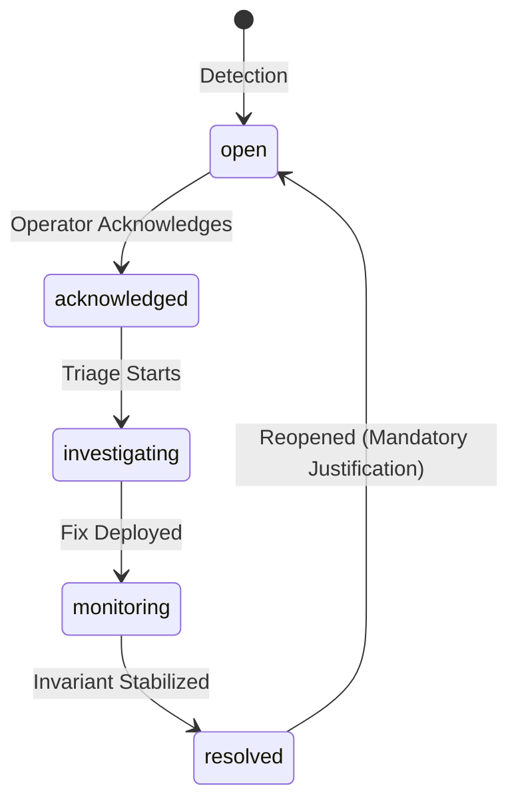

# E-09.14: System Health, Observability and Platform Operations Governance

## Executive Summary & Phase Scope

Phase **E-09.14: System Health, Observability and Platform Operations Governance** establishes an enterprise-grade, multi-tenant site reliability engineering (SRE) and platform operations governance suite inside the Super-Admin application (`dashboard/`).

As the platform owner application for the School Management SaaS platform, Super-Admins require deep, truthful, and accessible operational visibility into shared platform services, background queues, external API integrations, infrastructure saturation, disaster recovery readiness, and tenant configuration health without conflating simulated demo state with live telemetry.

### Core Deliverables Implemented
1. **Central System Health Workspace (`/system-health`)**: Interactive operational cockpit organizing 10 specialized governance views with component inventory, global health derivation, source classifications, and detailed component drawers.
2. **Observability & Metric Explorer**: Accessible, zero-dependency SVG timeseries telemetry visualization supporting P95, average, min, max aggregations, time-window filtering (`1h`, `6h`, `24h`, `7d`), and CSV exports fortified against formula injection.
3. **Incident Management Lifecycle Suite**: Deterministic incident lifecycle state machine (`open` -> `acknowledged` -> `investigating` -> `monitoring` -> `resolved`), chronological timeline capture, mandatory root-cause and resolution enforcement, and Mean Time to Resolution (MTTR) calculation.
4. **Maintenance Window Planning**: Scheduled maintenance coordination with datetime ordering validation, 15-minute minimum span, and overlap detection across shared affected components.
5. **Deployment & Release History**: Auditable release timeline tracking semantic version tags, environments, Git commit hashes, changelog summaries, and descriptive rollback status.
6. **Background Processing & External Integration Status**: Worker queue backlog visibility (BullMQ/Redis), throughput, failure summaries, and integration configuration checklists (Stripe, Twilio, AWS S3, State SIS Bridge) with zero credential leaks.
7. **Infrastructure Capacity Gauges**: Visual saturation monitors across CPU, RAM, PostgreSQL connection pools, Redis in-memory caches, and S3 object storage with explicit denominator handling.
8. **Backup & Disaster Recovery Readiness**: Audit-ready backup posture tracker detailing recovery objectives (RPO/RTO), checksum verification status, restore drill timestamps, and recovery runbook availability.
9. **Alert Rules & Threshold Configuration**: Rule builder supporting comparison operators, numeric thresholds, evaluation windows, and severity assignment with validation preventing incompatible units or negative thresholds.
10. **Multi-Tenant Operational Oversight (Zero PII Guarantee)**: Cross-tenant operational readiness evaluator inspecting tenant domain provisioning, SSL status, and shared dependency exposure while guaranteeing 100% data minimization (zero student names, grades, or guardian contacts).
11. **Platform Audit Integration**: Automated audit logging integrated with Phase E-09.13 audit log repository (`audit_logs`) capturing all operational mutations under `super-admin@edusat.io`.

---

## 1. Repository Discovery & Architecture Baseline

Before implementing this phase, an architectural inspection of `dashboard/` established the following:

- **Navigation & Routing**: Sidebar navigation contained `/system-health`, mapping to `app/system-health/page.tsx`. However, the page was previously a minimal placeholder with static mock cards and non-interactive status pills.
- **Data Layer**: Centralized in `lib/data/platform-store.ts`, which persists to `localStorage` under `edusat_platform_store_v1` and notifies React consumers through `PlatformStoreContext.tsx`.
- **Existing Contracts**: `lib/types/system-health.ts` contained legacy `PlatformServiceHealth` and `PlatformIncidentNotice` interfaces used in early fixtures. These were preserved in a backward-compatible union.
- **Audit Logging (E-09.13)**: The store already possessed an `auditEvents` repository and a `getAuditEvents()` query engine. All operational events generated in E-09.14 cleanly route to this existing audit log subsystem rather than creating a competing log store.
- **Styling & Design System**: Tailwind CSS v4, dark mode support via CSS variables, standard UI components (`DataTable`, `Badge`, `Modal`, `StatCard`), and Lucide icons. No third-party charting library was present in `package.json`.
- **Testing Architecture**: Native Node.js test runner executed via `tsx --test tests/**/*.test.ts`.

---

## 2. Routes & Navigation Added or Updated

| Path | Primary View | Purpose |
| :--- | :--- | :--- |
| `/system-health` | System Health Overview | Central operations hub displaying summary statistics, component inventory, and tabbed governance workspaces. |
| `/system-health?tab=components` | Component Inventory | Searchable, filterable directory of all 15 operational services with telemetry drawer. |
| `/system-health?tab=metrics` | Observability Explorer | Interactive SVG timeseries metric visualization and CSV export. |
| `/system-health?tab=incidents` | Incident Management | Operational incident lifecycle tracker, investigation timeline, and resolution workflow. |
| `/system-health?tab=maintenance` | Maintenance Windows | Forward planning for scheduled downtime with conflict and overlap detection. |
| `/system-health?tab=deployments` | Deployment History | Changelog and release tracking across environments (`production`, `staging`). |
| `/system-health?tab=jobs` | Background Jobs & Integrations | BullMQ worker queues and third-party API integration status. |
| `/system-health?tab=capacity` | Capacity & Saturation | System resource utilization gauges with threshold warnings. |
| `/system-health?tab=backups` | Backup & Disaster Recovery | Database snapshot audit, checksum verification, and RPO/RTO tracking. |
| `/system-health?tab=alerts` | Alert Rules | Threshold configuration demo with evaluation window validation. |
| `/system-health?tab=tenants` | Multi-Tenant Oversight | Organization technical readiness checklist with zero student PII. |

---

## 3. Data Models & Status Semantics

### 3.1 Component Health Status Semantics
Defined in `lib/system-health/types.ts`:

- `healthy`: All health checks passing. Key operational invariants are within nominal ranges.
- `degraded`: The service is operational but exhibiting performance degradation, elevated latency (P95 > 250ms), or partial replica lag.
- `critical`: The component is failing requests (HTTP 5xx > 2%), connection pool is exhausted, or primary ingress is unreachable.
- `unknown`: No telemetry heartbeat reported within the expected freshness window. Status is never coerced to healthy.
- `stale`: Telemetry exists but exceeds maximum age thresholds. Indicates telemetry pipeline disruption.
- `not_connected`: Planned architectural component with no active backend or external adapter attached.
- `maintenance`: Component is currently undergoing scheduled maintenance. Alert evaluations are suppressed.

### 3.2 Telemetry Source Classifications
To prevent misrepresenting mock data as live telemetry, every operational value carries an explicit `sourceClassification`:

1. `verified_codebase`: Facts established by directly inspecting the repository (e.g. routes, frontend dependencies).
2. `simulated_fixture`: Deterministic local fixture data demonstrating UI workflows. Explicitly labeled **Demo Data — No Live Monitoring Probe**.
3. `static_config`: Values established in application configuration or architectural specifications.
4. `not_connected`: Capabilities requiring a future backend or third-party API integration.
5. `unknown_stale`: Telemetry that cannot be verified or has expired.

---

## 4. Observability & Metric Definitions

All metrics in `INITIAL_METRIC_DEFINITIONS` are fully typed with defined units, aggregation methods, and expected telemetry sources:

| Metric Identifier | Metric Name | Category | Unit | Aggregation | Expected Telemetry Source |
| :--- | :--- | :--- | :--- | :--- | :--- |
| `metric_request_volume` | HTTP Ingress Request Volume | Request Volume | `req/s` | `average` | Envoy / NGINX Ingress Controller Exporter |
| `metric_request_latency_p95` | API Response Latency (P95) | Latency | `ms` | `p95` | OpenTelemetry HTTP Histograms |
| `metric_http_5xx_error_rate` | HTTP 5xx Server Error Rate | Error Rate | `%` | `average` | API Gateway Prometheus Scrape Target |
| `metric_cpu_utilization` | Container CPU Allocation | Saturation | `%` | `average` | cAdvisor / Kubernetes Metrics Server |
| `metric_memory_working_set` | Container RAM Working Set | Saturation | `MB` | `average` | cAdvisor / Pod Memory Working Set |
| `metric_db_connections` | Database Connection Pool | Saturation | `connections` | `max` | PostgreSQL `pg_stat_activity` Exporter |
| `metric_queue_depth` | Background Job Queue Depth | Queues | `jobs` | `max` | BullMQ Redis Queue Inspector |
| `metric_storage_utilization` | Object Storage Disk Usage | Storage | `TB` | `max` | AWS S3 CloudWatch Storage Metrics |

### Handling Missing Telemetry (Missing != 0)
Telemetry observations support `value: number | null` and `isMissing: boolean`.
- Missing values are rendered in charts as red dashed alert indicators labeled `MISSING`.
- Mathematical aggregations (`min`, `max`, `avg`, `p95`) calculate strictly over non-null observations.
- Missing values are **never coerced to 0**, which would otherwise artificially defang error spikes or latency averages.

### Formula Injection Protection
CSV export (`exportMetricsToCsv`) inspects every string and numeric cell. If a cell begins with dangerous spreadsheet formula triggers (`=`, `+`, `-`, `@`, `\t`, `\r`), it is prefixed with a single quote (`'`) to neutralize remote code execution / formula injection vulnerabilities.

---

## 5. Incident Lifecycle & MTTR Engine

### State Machine Transition Rules


1. **Linear Transitions**: `open` -> `acknowledged` -> `investigating` -> `monitoring` -> `resolved`.
2. **Resolution Validation**: Marked as `resolved` only when mandatory `rootCause` (minimum 5 chars) and `resolutionNotes` (minimum 10 chars) are supplied.
3. **Reopening Validation**: A resolved incident can only return to `open` when a mandatory `reopenReason` (minimum 5 chars) is documented.
4. **Timeline Auditing**: Every transition appends an immutable timeline event to the incident's internal history and records a parallel structured event in `platformStore.auditEvents`.
5. **MTTR Calculation**: Mean Time to Resolution is computed across all resolved incidents that possess both `detectedAt` and `resolvedAt` timestamps, formatting into clean hours and minutes.

---

## 6. Maintenance Planning & Conflict Detection

The maintenance workspace prevents conflicting operational windows:
- **Datetime Order**: Validates that `endTime` is strictly after `startTime`.
- **Minimum Span**: Rejects maintenance windows spanning less than 15 minutes.
- **Component Conflict Overlap**: Compares proposed start/end times against all active or scheduled windows. If two windows intersect and share at least one affected component (e.g. `comp_postgres_cluster`), the evaluator rejects the window and highlights the overlapping maintenance title.
- **Cancelled Windows**: Cancelled windows are excluded from overlap checks.

---

## 7. Multi-Tenant Privacy Guarantee (Zero PII)

Because this is a School Management SaaS, Super-Admins oversee tenant readiness without inspecting tenant-private academic or personal information:
- Evaluates: Custom domain configuration, SSL certificate status, provisioning state, lifecycle state, and shared platform service dependencies.
- Strict Data Minimization: Verified through automated unit tests asserting that no student names, student IDs, parent phone numbers, teacher salaries, or exam scores exist within the operational data pipeline.

---

## 8. Verification & Quality Assurance Results

### Test Suite Execution
Executed using native Node test runner (`npm test`):
```bash
npm test
```
- **Total Tests Executed**: 265
- **Passed**: 265
- **Failed**: 0
- **Duration**: ~800ms
- **New Tests Added**: 15 comprehensive unit and integration tests in `dashboard/tests/system-health-operations.test.ts`.

### TypeScript Type-Checking
Executed via TypeScript compiler:
```bash
npx tsc --noEmit
```
- **Result**: Passed with 0 errors across all dashboard files.

### ESLint Linter
Executed via Next.js ESLint runner:
```bash
npm run lint
```
- **Result**: Passed with 0 errors.

### Tenant Dashboard Immutability
`tenant-dashboard/` was inspected and treated as completely read-only. Exactly 0 files inside `tenant-dashboard/` were modified or created.

---

## 9. Known Limitations & Future Roadmap

1. **Frontend Mock Store**: All state mutations (incidents, maintenance windows, alert rules) operate in-memory and persist to client-side `localStorage`. Refreshing across different browser sessions does not synchronize state without a backend API.
2. **Chart Rendering**: Charting uses accessible zero-dependency SVG paths. Future iterations may adopt a headless charting engine once bundle-size constraints and third-party library guidelines are ratified.
3. **Notification Routing**: Alert rules and incidents display descriptive planned notification policies (e.g. `PagerDuty SRE (Planned)`, `Slack #platform-ops (Planned)`). No live webhooks, SMS messages, or emails are dispatched from the client.
4. **Synthetic Telemetry Heartbeat**: Component health is driven by deterministic fixtures. Live Prometheus / OpenTelemetry collectors will be connected during backend implementation phases.
