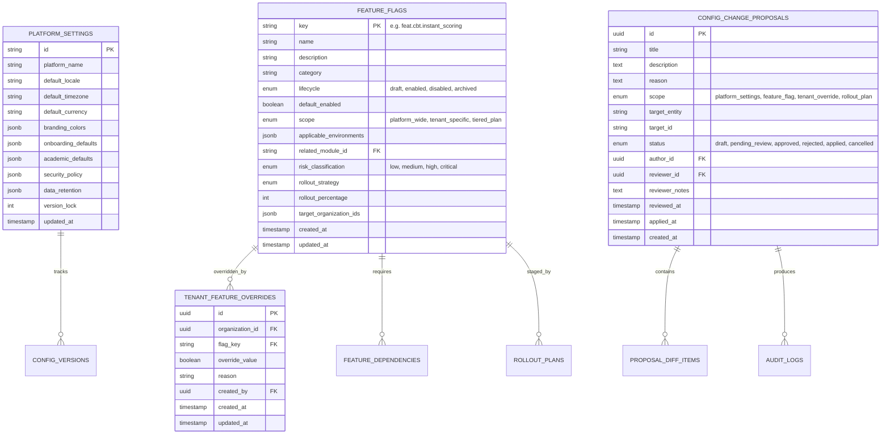
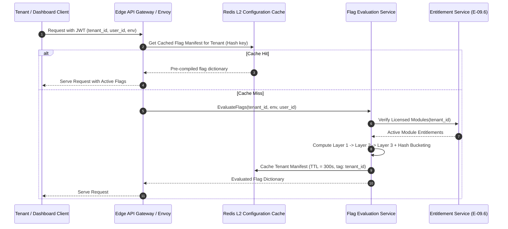

# Phase E-09.15 — Backend Readiness & Future Persistence Specification

## 1. Scope & Objective

This document specifies the technical architecture, data schemas, API contracts, caching mechanisms, security standards, and rollout evaluation algorithms required to support **Platform Configuration, Feature Flags, and Global Settings Governance** in future backend phases.

> **Crucial Architecture Rule**:
> No backend routes, controllers, database migrations, or live persistence were created during Phase E-09.15. All capabilities documented below serve as a forward-looking implementation blueprint for future backend development.

---

## 2. Proposed Data Architecture & Relational Schemas



### 2.1 Database Constraints & Indexes
1. `feature_flags(key)`: Unique primary key with regex constraint `^feat\.[a-z0-9_]+\.[a-z0-9_]+$`.
2. `tenant_feature_overrides(organization_id, flag_key)`: Unique composite index ensuring one override per flag per tenant.
3. `config_change_proposals(author_id, reviewer_id)`: Enforced check constraint `author_id != reviewer_id` on state transition to `approved` to guarantee true two-person Maker-Checker governance.

---

## 3. High-Performance Flag Evaluation Engine

### 3.1 Evaluation Pipeline
Feature flag evaluation must be ultra-low latency (< 5ms) as it executes on critical request paths across both Super-Admin and Tenant applications:



### 3.2 Consistent Hashing for Canary Rollouts
To ensure a tenant or user consistently lands in the enabled cohort without flapping between requests:
$$\text{Bucket Value} = \text{MurmurHash3}(\text{tenant\_id} + \text{flag\_key}) \pmod{100} + 1$$
If $\text{Bucket Value} \le \text{Rollout Percentage}$, the feature evaluates to **enabled** (subject to module licensing and dependency checks).

---

## 4. Proposed REST API Endpoints

### 4.1 Global Platform Settings
- `GET /api/v1/platform/config/settings`: Retrieve active global settings.
- `PUT /api/v1/platform/config/settings`: Propose or update platform settings (requires `system:config:write` permission and version lock for optimistic concurrency).

### 4.2 Feature Flags Management
- `GET /api/v1/platform/config/flags`: List all feature flags with optional filtering by category, lifecycle, or environment.
- `POST /api/v1/platform/config/flags`: Register a new feature flag.
- `GET /api/v1/platform/config/flags/:key`: Retrieve flag details, dependencies, and rollout status.
- `PATCH /api/v1/platform/config/flags/:key`: Update flag parameters or transition lifecycle state.
- `DELETE /api/v1/platform/config/flags/:key`: Archive or remove flag (prohibited if active dependencies exist).

### 4.3 Tenant Overrides
- `GET /api/v1/platform/config/overrides`: List tenant overrides (filter by `organization_id` or `flag_key`).
- `POST /api/v1/platform/config/overrides`: Set tenant-level flag override.
- `DELETE /api/v1/platform/config/overrides/:organization_id/:flag_key`: Delete override and restore inheritance.

### 4.4 Change Proposals & Governance
- `POST /api/v1/platform/config/proposals`: Create a change proposal.
- `GET /api/v1/platform/config/proposals`: List proposals by status.
- `POST /api/v1/platform/config/proposals/:id/review`: Approve or reject proposal with reviewer attribution and notes.
- `POST /api/v1/platform/config/proposals/:id/apply`: Apply approved proposal to database and invalidate cache.

### 4.5 Configuration Portability
- `POST /api/v1/platform/config/export`: Generate sanitized, versioned export package.
- `POST /api/v1/platform/config/import/validate`: Dry-run validation of uploaded JSON package.
- `POST /api/v1/platform/config/import/apply`: Execute validated import transaction.

---

## 5. Security & Zero-Secret Architecture

### 5.1 OWASP ASVS Level 3 Zero-Secret Enforcement
- **No Secrets in Config Tables**: The configuration database strictly disallows storing passwords, API secret tokens, or private keys.
- **KMS / Vault Pointer References**: Configuration items that interact with external services store only KMS key IDs or Vault secret paths (e.g. `arn:aws:secretsmanager:us-east-1:123456789012:secret:ses_smtp_key-AbCdEf`).
- **Sanitization Middleware**: Ingress and egress controllers automatically run recursive sanitization routines that reject payloads containing sensitive keywords (`password`, `private_key`, `secret`, `token`, `connection_string`).

### 5.2 Optimistic Concurrency Control (OCC)
To prevent lost updates when multiple Super-Admins adjust settings concurrently:
1. Every settings update must include the current `version_lock` integer.
2. The database executes:
   ```sql
   UPDATE platform_settings 
   SET branding_colors = :branding, version_lock = version_lock + 1, updated_at = NOW()
   WHERE id = :id AND version_lock = :expected_version;
   ```
3. If zero rows are affected, the API responds with `409 Conflict` and returns the latest state for three-way merging.

---

## 6. Cache Invalidation & Event Propagation

When a global setting or feature flag is modified:
1. The backend publishes a Redis Pub/Sub or Kafka event to topic `platform.config.events`:
   ```json
   {
     "event": "FEATURE_FLAG_UPDATED",
     "flagKey": "feat.cbt.instant_scoring",
     "newLifecycle": "enabled",
     "timestamp": "2026-10-19T14:00:00Z"
   }
   ```
2. Edge API gateways invalidate their local in-memory caches and evict the relevant Redis hashes.
3. Connected tenant dashboards receive a Server-Sent Events (SSE) notification or WebSocket message to refresh local entitlements without requiring a full page reload.

---

## 7. Rollback & Disaster Recovery Strategy

1. **Immediate Kill-Switch**:
   If a newly released feature induces high latency or database pressure, Super-Admins can toggle the flag's lifecycle to `disabled` via API or emergency CLI command. This propagates to Redis within 500ms.
2. **Snapshot Restoration API**:
   The backend stores immutable snapshots of the entire configuration state in `config_versions`. In the event of a corrupt mass import, an administrator can invoke `/api/v1/platform/config/restore/:version_id` to roll back the entire configuration tree within a single database transaction.
3. **Audit Trail Immutability**:
   All configuration modifications produce append-only audit events logged to both PostgreSQL and write-once compliance storage (AWS S3 Object Lock) in compliance with SOC 2 Type II and GDPR standards.
