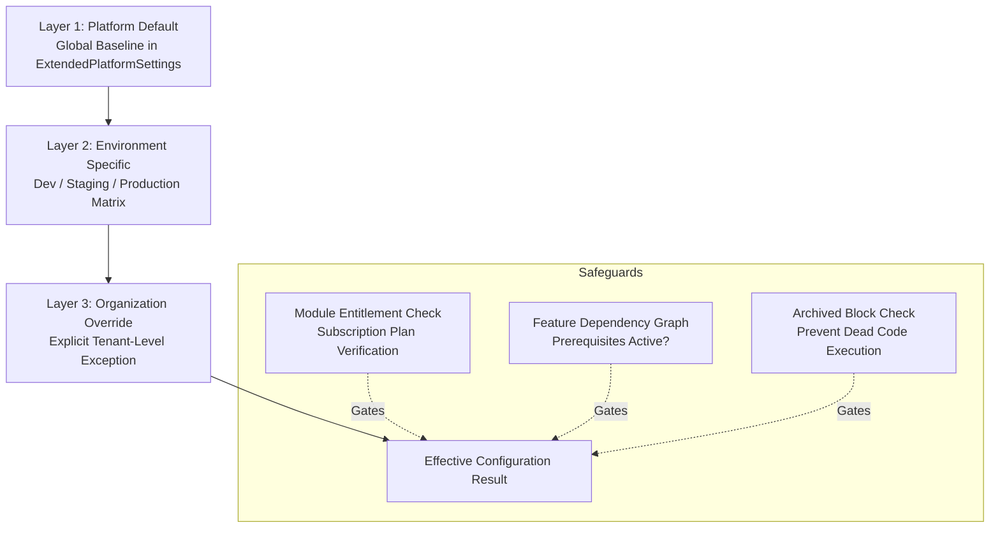
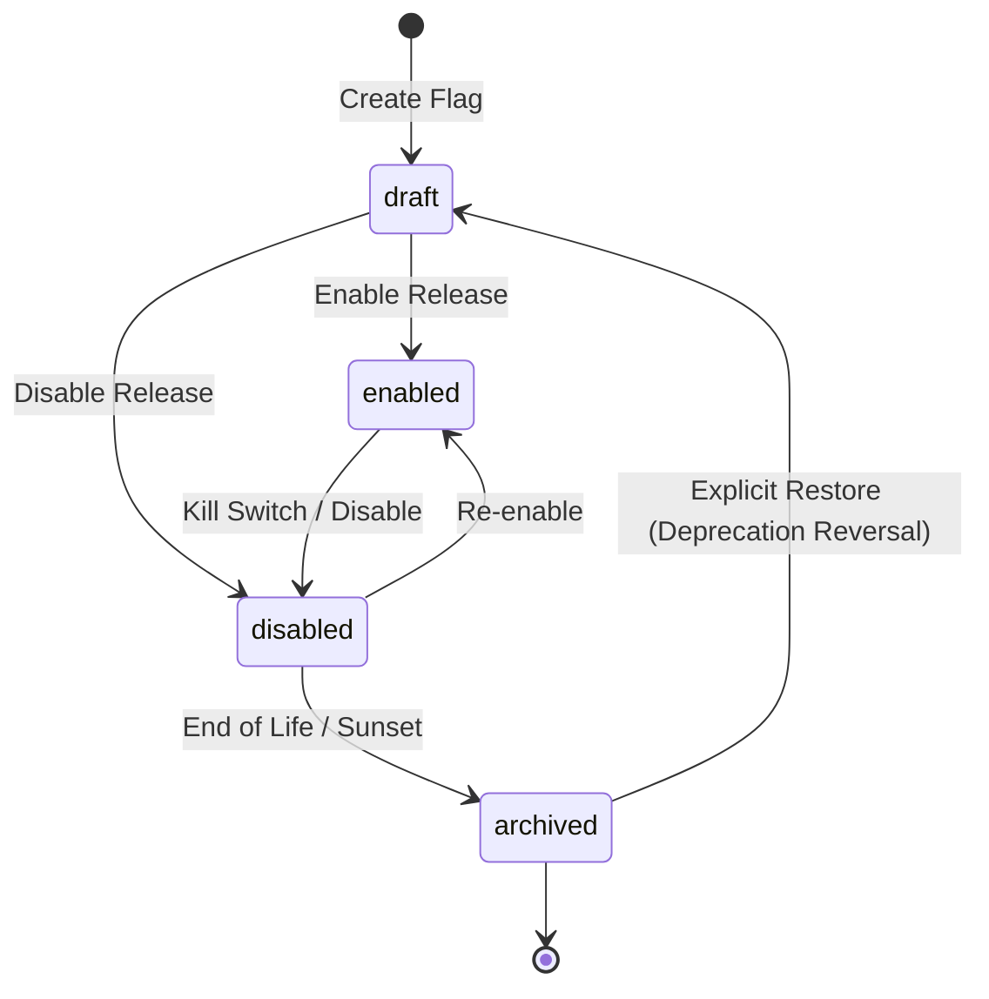

# Phase E-09.15 — Platform Configuration, Feature Flags and Global Settings Governance

## 1. Executive Summary & Architecture Overview

Phase **E-09.15: Platform Configuration, Feature Flags and Global Settings Governance** delivers an enterprise-grade multi-tenant configuration and release-engineering workspace for Super-Admins in the platform owner application (`dashboard/`).

Prior to E-09.15, global settings were limited to a rudimentary 4-tab form with minimal typing, no formal scope precedence, no release gating, and no dual-control governance. E-09.15 elevates platform settings into an integrated 7-module configuration management suite with:
- Strict **Three-Layer Scope Precedence**: Layer 1 (Platform Default) → Layer 2 (Environment Specific) → Layer 3 (Tenant Override).
- An explicit domain distinction separating **Feature Flags** (release gating), **Module Entitlements** (licensing tiers, E-09.6), **User Permissions** (IAM authorization, E-09.12), and **Tenant Configurations** (school-specific academic parameters).
- **Dual-Control (Maker-Checker) Change Governance** with before-and-after visual diffs, reviewer sign-offs, and state transitions (`draft` → `pending_review` → `approved` → `applied_locally`).
- An **OWASP ASVS Level 3 Zero-Secret Guarantee** ensuring passwords, API keys, database URLs, and cryptographic private keys are never stored, displayed, previewed, or exported in plaintext.
- **Canary Rollout Planning** with scope estimation across eligible tenant cohorts.
- Timestamped **Configuration Version History** with point-in-time diff inspections, snapshot restoration, and safe JSON package export/import.
- Full compliance with the **Frontend-First Roadmap**: zero backend code, zero modifications to `tenant-dashboard/`, and clear disclaimers that changes update local demonstration state.

---

## 2. Repository Findings & Prior Phase Integration

During repository discovery, the following foundations were reviewed and integrated:
1. **Module Registry & Entitlements (E-09.6)**:
   - Located at `dashboard/lib/modules/` and `/features`.
   - Reused module identifiers (`cbt_system`, `finance_bursary`, `admissions_portal`, etc.) to enforce entitlement gating. When a feature flag declares `relatedModuleId`, the evaluator checks whether an organization's subscription plan entitles them to that module before activating the flag.
2. **Platform Store Architecture**:
   - `dashboard/lib/data/platform-store.ts` manages reactive in-memory state with localStorage persistence (`sms_superadmin_dev_store_v1`).
   - Extended with typed arrays for `extendedSettings`, `featureFlags`, `tenantOverrides`, `environments`, `changeProposals`, and `configVersions`.
   - Every mutation automatically creates structured audit log entries categorized under `system_configuration` and `feature_toggles`.
3. **Audit Logs & Security Governance (E-09.13)**:
   - Configuration adjustments, flag toggles, rollout plan updates, and version restorations publish immutable `AuditEvent` records with actor attribution, severity, and change summaries.
4. **Platform Settings Navigation**:
   - Linked from primary navigation sidebar (`/settings`).
   - Subordinated from a basic form to a comprehensive 7-tab governance command center.

---

## 3. Configuration Precedence & Domain Hierarchy

### 3.1 Precedence Layers
The platform configuration engine evaluates settings and toggles using a deterministic three-layer hierarchy:

1. **Layer 1: Platform Default**:
   The baseline setting or flag state applicable platform-wide across all tenants and environments unless overridden.
2. **Layer 2: Environment Override**:
   Environment-specific applicability rules (e.g. enabling experimental AI grading flags exclusively in `development` or `staging`).
3. **Layer 3: Organization Override**:
   Targeted tenant-specific exceptions (e.g. enabling biometric proctoring for a pilot trial at a specific secondary school).

### 3.2 Safe Failure Guarantee (Never Fails Open)
If any layer in the hierarchy encounters an unresolved dependency, a disabled prerequisite, an unlicensed module entitlement, or an archived flag state:
- The system **never fails open**.
- The effective state defaults strictly to **disabled (`false`)**.
- A clear diagnostic `failureReason` and `entitlementNotice` are attached to the evaluation result.

### 3.3 Domain Separation Matrix

| Concept | Primary Domain Owner | Definition | Overridden by Feature Flag? |
| :--- | :--- | :--- | :--- |
| **Module Entitlement** | Licensing & Subscriptions (E-09.6 / E-09.11) | Whether a school is legally licensed to access a module tier (e.g. CBT module in Enterprise Plan). | **No.** If unlicensed, feature flag evaluation safely fails closed. |
| **Feature Flag** | Release Engineering & Product Management | Release gating, canary rollout, or dark launching of specific functional components. | N/A (Controls release execution). |
| **User Permission** | IAM & Access Governance (E-09.12) | Whether an authenticated user role (e.g. Principal, Exam Officer) can perform an action. | **No.** User must possess requisite IAM permission even if flag is enabled. |
| **Tenant Configuration** | School Management | School-specific academic sessions, term dates, grading scales, and fee thresholds. | **No.** Dictates how a feature behaves within an entitled tenant. |

---

## 4. Implemented Workspaces & UI Modules

The workspace is assembled in `dashboard/app/settings/page.tsx` across 7 dedicated panels in `dashboard/components/platform-config/`:

### 4.1 Global Settings & Policies (`GlobalSettingsPanel.tsx`)
Configures platform-wide operational baselines across 8 organized categories:
- **General Platform Settings**: Platform display name, legal entity name, support contact email, technical support phone.
- **Branding & Visual Identity**: Platform primary hex color, secondary color, logo URL, favicon URL, with live visual contrast preview.
- **Localization & Regional Preferences**: Default locale (`en-US`, `en-GB`, `fr-FR`, etc.), default time zone (IANA database), date format (`YYYY-MM-DD`, `DD/MM/YYYY`), time format (`12h` vs `24h`), default currency (`USD`, `GBP`, `NGN`, `KES`, etc.), and week start day.
- **Organization Onboarding Defaults**: Default grace period days, trial duration days, self-service domain provisioning toggle, auto-provision initial academic session toggle.
- **Academic Policy Defaults**: Default grading system, passing grade threshold, multi-term year toggle, continuous assessment weight percentage.
- **Notification & Communication Policy**: System alerts sender email, SMS dispatch threshold, mandatory security digests toggle.
- **Security & Session Governance**: Session timeout minutes, enforce 2FA for staff toggle, password rotation days, maximum failed attempts lockout.
- **Data Retention & Lifecycle Governance**: Audit log retention days (default 2555 days / 7 years), student academic record retention days, soft delete grace days.

### 4.2 Feature Flags Registry (`FeatureFlagsRegistry.tsx`)
A searchable, filterable registry of platform release toggles with:
- Key naming convention: `feat.<category>.<feature_name>`.
- Categorized across 10 functional domains: CBT, Admissions, Academics, Finance, HR, Communication, Reporting, Integrations, Operations, and Experimental.
- Real-time search, category filter, lifecycle filter, and risk classification indicators (`low`, `medium`, `high`, `critical`).
- Inspection drawer displaying metadata, owner, environment applicability, dependencies, related module entitlement, and audit history.
- Pre-save change preview modal (`ConfigChangePreviewModal.tsx`) showing side-by-side diffs, affected scope, and validation warnings before applying.

### 4.3 Tenant Overrides & Scopes (`TenantOverridesPanel.tsx`)
Allows Super-Admins to inspect and configure tenant-specific feature flag overrides:
- School selector with quick metadata (ID, tier, student population).
- Inheritance inspector showing effective flag state, resolution scope (Platform Default vs Tenant Override), and entitlement validation.
- "Create / Edit Override" modal with mandatory reason justification and actor attribution.
- "Remove Override" action that instantly restores inheritance from the platform default layer.

### 4.4 Environments & Zero-Secret Safety (`EnvironmentConfigPanel.tsx`)
Provides environment visibility and security compliance:
- Environment cards for `development` (Isolated Sandbox), `staging` (Pre-production Mirror), and `production` (High-Availability Cluster).
- Prominent **OWASP Zero-Secret Guarantee Banner**: explains that plaintext passwords, connection strings, and API keys are never exposed in the dashboard.
- Managed Secret References Table: lists environment keys (`DATABASE_URL`, `JWT_SIGNING_KEY`, `STRIPE_WEBHOOK_SECRET`, etc.) with safe status badges (`Reference Configured`, `Secret Required`, `Missing In Vault`, `Unconnected Provider`), attested KMS provider (AWS Secrets Manager, HashiCorp Vault), and last rotation timestamp.
- Environment feature flag matrix showing which flags are deployed to each environment tier.

### 4.5 Rollout Planning Simulator (`RolloutPlannerPanel.tsx`)
A staged release demonstration workspace:
- Target flag selector with automated exclusion of archived flags.
- 4 rollout strategy models:
  1. *All Eligible Tenants*: 100% release to licensed institutions.
  2. *Canary Percentage (%)*: Interactive slider (1% to 100%) with cohort milestones (Alpha, Canary, Cohort Beta, General Availability).
  3. *Selective Organizations*: Pilot institution allowlist with multi-select checkboxes.
  4. *Scheduled Timeline*: Start and end date calendar bounds.
- Live scope demonstration card: computes eligible tenant count, targeted tenant count, and aggregated affected students/staff.
- Pre-execution validation checking for cycle-free dependencies and module licensing.

### 4.6 Change Governance & Approval Workflows (`ChangeGovernancePanel.tsx`)
Dual-control (Maker-Checker) workflow demonstration:
- Metrics summary: Pending Review, Approved, Applied Locally, Total Proposals.
- Proposal submission modal capturing title, target scope, target entity ID, governance justification, and itemized diff fields.
- Full inspection modal displaying author details, timestamp, rationale, visual side-by-side diff table, and reviewer decision notes.
- Workflow transitions: `draft` → `pending_review` → `approved` / `rejected` → `applied_locally`.
- Applying approved proposals immediately updates the local platform store and records a categorized audit event.

### 4.7 Version History & Portability (`ConfigVersionHistoryPanel.tsx`)
Audit history, diff comparison, and safe JSON portability:
- Chronological version snapshot table tracking entity type, action (`CREATE`, `UPDATE`, `TOGGLE`, `OVERRIDE`, `RESTORE`), operator, reason, and field diffs.
- Point-in-time diff modal showing before/after values.
- One-click snapshot restoration reverting local demonstration state to historical values.
- Safe JSON Export: exports settings, flags, or overrides with schema version `1.0.0` and recursive stripping of any secret-like fields.
- Safe JSON Import: pre-validation report computing create/update/skip/reject counts, detecting schema errors or disallowed secrets before applying.

---

## 5. Feature Flag Lifecycle States

Feature flags follow an explicit, enforced state machine:

- **Draft**: Newly created toggle undergoing review or local validation.
- **Enabled**: Active release toggle participating in evaluation.
- **Disabled**: Feature intentionally turned off globally.
- **Archived**: Deprecated or sunset feature. Direct activation is strictly blocked; must be restored to `draft` first.

---

## 6. Testing & Quality Assurance Summary

Automated tests for E-09.15 are implemented in `dashboard/tests/platform-config-governance.test.ts` covering:
1. **Platform Settings Validation**:
   - Valid settings acceptance.
   - Rejection of empty platform names, unsupported locales, invalid IANA time zones, unlisted currencies, and malformed hex color codes.
2. **Feature Flag Validation & Lifecycle**:
   - Dot-notation key format enforcement.
   - Uniqueness check preventing duplicate keys.
   - Lifecycle state machine transitions and blocking of direct activation from `archived`.
   - DFS cycle detector identifying circular dependencies (A → B → C → A).
   - Flag validation flagging non-existent dependency references.
3. **Scope Precedence & Safe Failure**:
   - Layer 1 resolution when no overrides exist.
   - Layer 3 tenant override precedence over platform defaults.
   - Isolation test confirming overrides apply only to target tenant and do not leak.
   - Safe failure gating: missing or disabled dependencies cause flag evaluation to fail closed (`false`).
   - Entitlement gating: unentitled module subscriptions cause flag evaluation to fail closed (`false`).
4. **Rollout Planning**:
   - Validation of percentage ranges (1-100%).
   - Rejection of rollout plans on archived flags.
   - Date validation ensuring start dates precede end dates.
   - Consistent computation of eligible/targeted tenant counts and user estimates.
5. **Change Governance & Approval Workflows**:
   - Proposal creation requiring title and governance justification.
   - Maker-Checker lifecycle transitions (`draft` → `pending_review` → `approved` → `applied_locally`).
   - Store updates and audit logging on applied proposals.
   - Rejection enforcement preventing unapproved proposals from mutating state.
   - Version restoration applying prior values and publishing restoration audit events.
6. **Zero-Secret Export & Import**:
   - Recursive sanitization scrubbing sensitive keys (`password`, `apiKey`, `jwtSecret`, etc.).
   - Export verification ensuring valid JSON and schema version `1.0.0`.
   - Pre-validation of import packages without premature store mutation.
   - Rejection of mismatched schema versions and payloads containing secret-like keys.

---

## 7. Limitations & Future Backend Transition

- **Browser Storage Boundary**: All configuration updates, flags, overrides, and governance proposals are stored in browser localStorage (`sms_superadmin_dev_store_v1`). No live cloud infrastructure, database tables, or backend APIs are modified.
- **Decoupled Tenant App**: The tenant-facing application (`tenant-dashboard/`) remains untouched and does not enforce feature flags during this phase.
- **Simulated Rollout Engine**: Consistent tenant bucketing and percentage hashing are demonstrated via client-side estimations; production canary rollouts require a centralized backend evaluation service.
