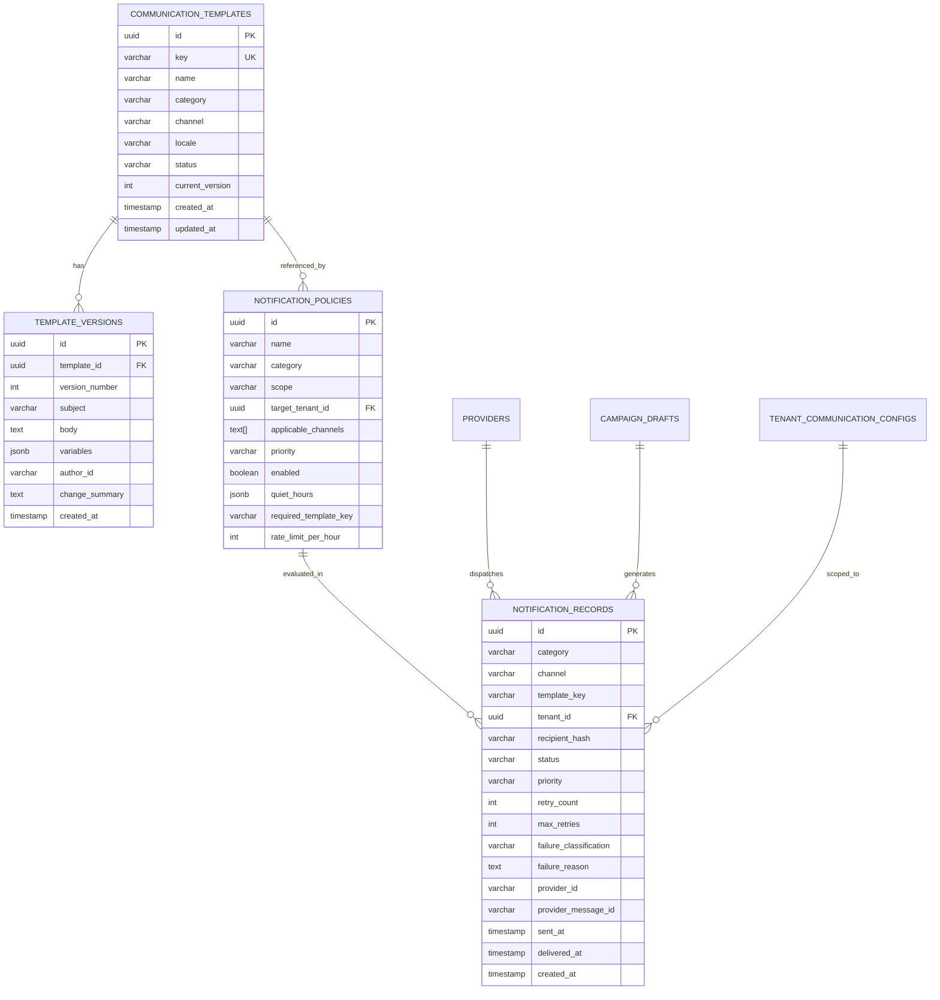

# Phase E-09.16 — Backend Readiness Specification: Platform Notifications & Communications Engine

## 1. Overview & Scope

This specification defines the backend architectural requirements, database schemas, queue processing workflows, security standards, and integration interfaces necessary to implement the production communications engine designed in **Phase E-09.16: Platform Notifications, Communication Templates and Delivery Governance**.

> [!WARNING]
> **Proposed Architectural Specifications Only**
> In strict accordance with the frontend-first development roadmap, no backend code, server routes, database migrations, message queue consumers, or third-party communications SDKs have been implemented during this phase. All interfaces and contracts described herein represent technical requirements for future backend engineering.

---

## 2. Proposed Data Architecture & Relational Schemas

---

## 3. Queueing, Worker Architecture & Idempotency

### 3.1 Distributed Message Queues (BullMQ / RabbitMQ / SQS)

1. **Multi-Queue Priority Partitioning**:
   - `queue:notifications:critical`: Reserved exclusively for 2FA verification, password resets, and account lockouts (Target latency: < 1.5s).
   - `queue:notifications:transactional`: Invoices, receipts, campus provisioning updates (Target latency: < 10s).
   - `queue:notifications:broadcast`: Platform maintenance advisories, feature release campaigns (Rate-controlled batch processing).
2. **Idempotency & Deduplication Engine**:
   - Every inbound notification trigger must supply or compute an `idempotency_key` (e.g., `SHA-256(tenant_id + category + recipient + payload_hash + date_bucket)`).
   - Redis `SET key value NX EX 300` prevents accidental double-dispatches when upstream services retry API calls.

---

## 4. Provider Adapters & Credential Management (Zero-Secret Architecture)

1. **Cloud KMS / HashiCorp Vault Integration**:
   - The production backend must never store API keys or SMTP passwords in plaintext application databases or git repositories.
   - Provider adapters must resolve credentials dynamically at runtime via AWS Secrets Manager, GCP Secret Manager, or HashiCorp Vault using short-lived IAM roles.
2. **Circuit Breaker Pattern**:
   - Each provider adapter (Amazon SES, Twilio, FCM, Meta WhatsApp) must implement a circuit breaker (e.g. using `opossum`).
   - If a provider reports consecutive HTTP 5xx errors or rate-limit thresholds exceeding 5%, the circuit trips to `OPEN`, rerouting traffic to secondary backup pools (e.g. Twilio fallback for SMS, SendGrid fallback for SES).

---

## 5. Delivery Receipts & Status Reconciliation (Webhooks)

1. **Asynchronous Webhook Ingestion**:
   - Dedicated webhook endpoints must authenticate cryptographically signed payloads:
     - Amazon SES: SNS HTTPS subscription with certificate validation.
     - Twilio: `X-Twilio-Signature` HMAC-SHA1 header verification.
     - Meta WhatsApp: `X-Hub-Signature-256` HMAC validation.
2. **Status Reconciliation**:
   - Transition from `sent` to `delivered` occurs **only** when a valid Delivery Receipt (DLR / 250 OK) is parsed.
   - Hard bounces (`invalid_destination`, `550 User Unknown`) must automatically flag the recipient address in the tenant's suppression list.

---

## 6. Retry Policies & Dead-Letter Queues (DLQ)

1. **Exponential Backoff with Jitter**:
   - Failed notifications classified as `rate_limited` or `provider_unavailable` retry with exponential backoff:
     $$\Delta t = 2^{\text{attempt}} \times 30\text{s} \pm \text{random\_jitter}(5\text{s})$$
2. **Dead-Letter Queue (DLQ)**:
   - When `retry_count >= max_retries`, the message transitions to `failed` and moves to `dlq:notifications`.
   - Platform operations alerts notify Super-Admins of sustained DLQ accumulation.
3. **Suppressed Notification Safeguard**:
   - Messages suppressed by quiet-hours or policy filters must **never** be enqueued into the retry worker.

---

## 7. Campaign Scheduling & Audience Resolution

1. **Audience Resolution Worker**:
   - Scheduled broadcast campaigns must resolve recipients asynchronously in batches of 500 records.
   - Tenant scoping must verify active subscription status and institutional channel permissions before enqueueing child delivery records.
2. **Rate Limiting & Carrier Throttling**:
   - SMS and WhatsApp campaigns must enforce maximum throughput constraints (e.g. 50 messages/sec for SMS shortcodes) to prevent carrier spam filtering.

---

## 8. Privacy, Consent & GDPR/FERPA Compliance

1. **PII Masking & Recipient Hashing**:
   - The platform governance delivery log must store recipient coordinates using one-way cryptographic hashes (`HMAC-SHA256(recipient, platform_salt)`) or masked representations (`a***r@school.edu`).
2. **Explicit Consent & Opt-Out Enforcement**:
   - The backend must evaluate tenant and user opt-out tables before dispatching marketing or announcement categories.
   - Mandatory transactional communications (`account_verification`, `security_alerts`, `subscription_billing`) are legally designated as system-critical and bypass marketing opt-out filters.

---

## 9. Security, Authorization & Audit Persistence

1. **Role-Based Access Control (RBAC)**:
   - Template approval and activation require `super_admin` or `communications_officer` permissions.
   - Regular platform staff can create `draft` templates but cannot approve or publish them (dual-control principle).
2. **Audit Event Generation**:
   - All backend administrative mutations publish immutable `AuditEvent` records to the audit log database partitioned by year and month.
