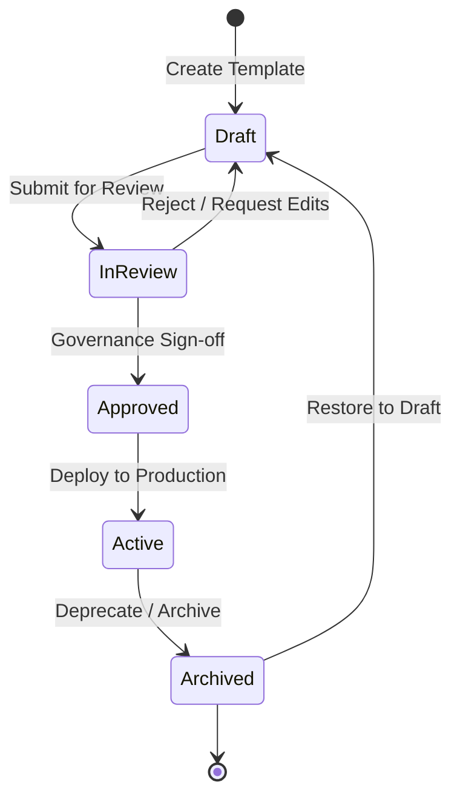
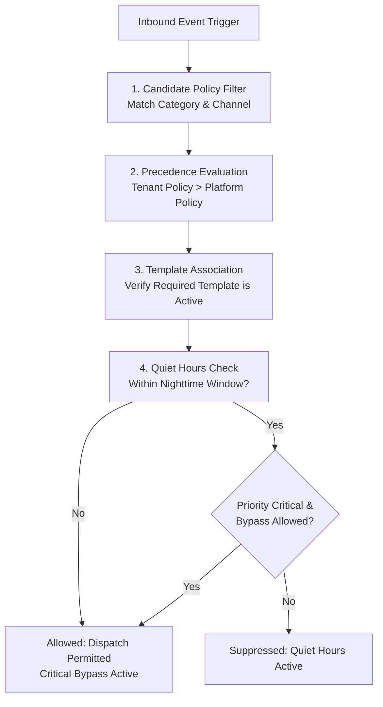

# Phase E-09.16 — Platform Notifications, Communication Templates and Delivery Governance

## 1. Executive Summary & Architecture Overview

Phase **E-09.16: Platform Notifications, Communication Templates and Delivery Governance** delivers an enterprise-grade, multi-tenant communication operations and governance workspace for Super-Admins in the platform owner application (`dashboard/`).

Prior to E-09.16, communication management across the SaaS platform was limited to isolated toast alerts and hardcoded notification labels. There was no centralized template registry, no variable dictionary, no quiet-hours policy enforcement, no delivery lifecycle observability, and no multi-channel governance across the 5 primary SaaS channels (Email, SMS, In-App, Mobile Push, and WhatsApp).

E-09.16 introduces an integrated 8-tab governance workspace with 14 core capabilities:
1. **Notification Operations Overview**: Real-time aggregated operational metrics with source and verification scope badges, audit activity stream, and quick navigation.
2. **Communication Template Registry**: Centralized catalog of platform message templates with category, channel, and locale filtering, status badges, and search.
3. **Template Editor & Safe Variable Palette**: Structured editor with dynamic double-brace `{{var}}` variable chips, GSM-7/UCS-2 SMS segment counters, and instant syntax validation.
4. **Multi-Channel Safe Preview & Device Frames**: Realistic client previews for Email (desktop client chrome), SMS (mobile handset frame), In-App (top toast banner), Mobile Push (lockscreen notification), and WhatsApp (chat bubble), with client-side HTML escaping to neutralize XSS.
5. **Template Versioning & Dual-Control Lifecycle**: Strict linear lifecycle (`draft` → `in_review` → `approved` → `active` → `archived`), immutable version history tracking, and point-in-time "Restore to Draft" workflows.
6. **Notification Policy Management**: Configurable delivery rules governing allowed channels, priority tiers, quiet-hours suppression windows, and rate limits.
7. **Interactive Policy Simulation Sandbox**: Local evaluation tester calculating suppression decisions, quiet-hours checks, critical bypasses, and candidate template matches.
8. **Channel & Provider Readiness (OWASP Zero-Secret Guarantee)**: Safe visibility into gateway readiness tiers (`UI Available`, `Demo Model`, `Verified Connected`, `Backend Ready`), strictly referencing encrypted vault coordinates (`vault://...`) with zero clear-text credentials.
9. **Delivery History & Message Lifecycle Explorer**: Deterministic delivery logs with clear distinction between provider acceptance (`sent`) and confirmed destination receipts (`delivered`).
10. **Failure Analysis & Simulated Retry Workflows**: Categorized failure triage (`invalid_destination`, `provider_unavailable`, `rate_limited`, `missing_configuration`) with local retry simulations and reviewer notes.
11. **Campaign & Broadcast Planning**: Platform announcement planner with live audience estimation across tenant cohorts (`all_schools`, `tier_enterprise`, `tier_growth`, `selected_tenants`).
12. **Tenant Communication Configuration**: Institutional channel toggles, custom from-name branding, and honest unverified consent disclaimers.
13. **Notification Preferences & Suppression Matrix**: Governance matrix establishing mandatory platform notices (security, billing) versus configurable communications.
14. **Safe Configuration Export & Import**: Zero-secret JSON configuration package exporter with formula injection protection (`=`, `+`, `-`, `@`) and pre-import schema validation.

---

## 2. Repository Findings & Prior Phase Integration

During preliminary inspection, the existing frontend architecture was evaluated to ensure seamless alignment:
1. **Super-Admin Navigation & Layout**:
   - Sidebar (`dashboard/components/layout/Sidebar.tsx`) and TopBar (`dashboard/components/layout/TopBar.tsx`) were updated to integrate `Communications & Delivery` under the **Operations & Settings** group at `/communications`.
2. **Platform Store Architecture (`dashboard/lib/data/platform-store.ts`)**:
   - Extended with typed private state collections: `communicationTemplates`, `templateVersionHistory`, `notificationPolicies`, `communicationProviders`, `notificationRecords`, `campaignDrafts`, `tenantCommunicationConfigs`, and `notificationPreferenceGovernance`.
   - All mutations trigger automated audit trail logging using the standard `logAuditEvent()` contract established in E-09.13.
3. **Audit Logs & Compliance Governance (E-09.13)**:
   - Template creations, lifecycle status transitions, policy modifications, campaign submissions, and retry simulations emit structured audit events with correlation IDs, severity classifications, and Super-Admin actor attribution.
4. **Subscription Plans & Organization Registry (E-09.6 / E-09.7 / E-09.11)**:
   - Reused existing organization records (`INITIAL_ORGANIZATIONS`) and plan tiers (`plan_enterprise`, `plan_growth`, `plan_starter`) for audience calculations and tenant communication visibility.
5. **Frontend-First Boundary Compliance**:
   - Strictly confined to `dashboard/`. Zero backend routes, databases, server workers, or third-party provider SDKs were introduced.
   - `tenant-dashboard/` remained completely untouched.

---

## 3. Communication Channels & Supported Categories

### 3.1 Supported Delivery Channels

| Channel | Identifier | Supported Encodings / Constraints | Representative Providers |
| :--- | :--- | :--- | :--- |
| **Email** | `email` | HTML & Plaintext; Requires Subject line | Amazon SES, SendGrid, Postmark |
| **SMS** | `sms` | GSM-7 (160 chars/segment; 153 concatenated) / UCS-2 (70 chars/segment) | Twilio, MessageBird, Infobip |
| **In-App** | `in_app` | Markdown / Plaintext banner toast; Action URL supported | Internal SaaS WebSocket Engine |
| **Mobile Push**| `push` | Title & Body; High priority payload | Firebase Cloud Messaging (FCM), APNs |
| **WhatsApp** | `whatsapp` | Meta Cloud API HSM approved template format | Meta Cloud API, Twilio WhatsApp |

### 3.2 Supported Notification Categories

1. `account_verification`: Critical transactional verification codes and activation links.
2. `password_reset`: Time-sensitive credentials recovery with security expiry parameters.
3. `welcome_onboarding`: Tenant leadership initial provisioning guidance and credentials.
4. `org_provisioning`: Automated infrastructure readiness notifications for new campuses.
5. `subscription_billing`: Invoices, receipts, trial expirations, and dunning advisories.
6. `platform_maintenance`: Scheduled maintenance windows and downtime advisories.
7. `security_alerts`: Multi-channel lockout notices and abnormal login location warnings.
8. `administrative_alerts`: Operational capacity, exam scheduling, and compliance notices.
9. `school_onboarding`: Milestone checklists for newly enrolled educational institutions.
10. `platform_announcements`: Quarterly release newsletters and major feature broadcast campaigns.

---

## 4. Template Lifecycle, Versioning & Variable Registry

### 4.1 Strict Linear Lifecycle State Machine



- **Draft**: Working copy under construction. Cannot be evaluated by policies or targeted by campaigns.
- **In Review**: Submitted for dual-control editorial review. Read-only pending approval or rejection back to Draft.
- **Approved**: Verified by platform governance. Eligible for campaign planning and scheduled release.
- **Active**: Production template actively evaluated by notification policy engine.
- **Archived**: Deprecated template. Preserved in version history; completely blocked from live dispatches and campaigns unless restored to Draft.

### 4.2 Safe Variable Registry (`TEMPLATE_VARIABLE_REGISTRY`)

All dynamic parameters must resolve to predefined, non-sensitive tokens. No student health, medical, credit card, or unhashed password variables exist in the registry:

- `recipientName`: Display name of recipient (e.g. Dr. Eleanor Vance).
- `organizationName`: Legal name of the school institution (e.g. Oak Hill Academy).
- `platformName`: Global platform display name (SchoolSaaS Platform).
- `supportContact`: Official support email contact coordinate.
- `actionUrl`: Action link with security token parameter.
- `expiryDate`: Expiration timestamp for verification or reset token.
- `maintenanceWindow`: Scheduled time range for maintenance.
- `invoiceAmount`: Due payment total for subscription billing notices.
- `dueDate`: Payment deadline date.
- `featureName`: Name of newly launched software capability.
- `eventName`: Type of administrative or security incident triggered.
- `campusName`: Name of primary or satellite campus.
- `securityEventDetails`: High-level synopsis of security warning.

### 4.3 Template Preview Safety & Sanitization

To ensure template previews do not execute arbitrary script injections:
- All custom variable inputs pass through `escapeHtml()` prior to DOM insertion.
- Dangerous characters (`<`, `>`, `"`, `'`, `/`, `&`) are converted to their corresponding HTML entities.
- Unresolved tokens render safe warning fallbacks: `[MISSING: variableName]`.

---

## 5. Policy Model & Precedence Architecture

Notification policies govern when messages are dispatched, quieted, or suppressed:



1. **Category & Channel Matching**: Filters enabled policies matching the trigger.
2. **Scope Precedence**: Tenant-specific policies override platform-wide baseline policies.
3. **Template Verification**: Warns or blocks if the referenced template is missing or inactive.
4. **Quiet Hours Evaluation**: Computes whether the current UTC time falls within quiet hours (e.g., 22:00 to 07:00 UTC).
5. **Critical Priority Bypass**: High-urgency security notices (`priority: 'critical'`) bypass nighttime suppression windows when `allowCriticalBypass: true`.

---

## 6. Provider Readiness & Delivery Semantics

### 6.1 Provider Readiness Tiers (Zero-Secret Guarantee)

Providers distinguish four distinct operational tiers:
- **UI Available**: Channel controls and fields exist in the dashboard UI.
- **Demo Model**: Local synthetic dispatcher simulates delivery behaviors.
- **Verified Connected**: Authenticated external gateway verified via backend health checks. (Always `false` in frontend demo).
- **Backend Ready**: Production cloud worker and queue consumer implemented. (Always `false` in frontend demo).

> [!IMPORTANT]
> **Zero-Secret Guarantee**: No plaintext credentials, AWS access keys, or API tokens are loaded into memory, localStorage, or export payloads. Every provider record stores only an encrypted vault coordinate pointer (e.g. `vault://platform/secrets/communications/aws_ses_smtp_credential`).

### 6.2 Delivery Status State Machine

```
queued ───> processing ───> sent ───> delivered
   │                           │
   └───> suppressed            └───> failed (retryable / non-retryable)
```

- **Sent vs. Delivered Distinction**: `sent` denotes that the gateway adapter accepted the payload (e.g. SMTP 250 relay). `delivered` is reserved exclusively for records that have received an explicit simulated carrier delivery receipt (DLR) or destination MTA confirmation.
- **Suppressed Notifications**: Suppressed records are terminal decisions by policy; they cannot be retried directly without policy re-evaluation.

---

## 7. Safe Export & Formula Injection Safeguards

### 7.1 JSON Configuration Package
Exports include templates, policies, provider references, and campaign drafts. All internal database IDs are stripped, credentials are completely omitted, and all user-facing text strings are sanitized.

### 7.2 Formula Injection Protection
When generating CSV delivery records, any cell starting with `=`, `+`, `-`, `@`, `\t`, or `\r` is automatically prepended with a single quote (`'`). This prevents spreadsheet software (Excel, LibreOffice, Google Sheets) from executing dangerous formulas upon opening exported reports.

---

## 8. Test Coverage & Verification Evidence

Automated unit and integration testing was executed using the native Node.js test runner via `tsx`:

```bash
# Isolated communications test suite
npx tsx --test tests/communications-governance.test.ts
# Full platform test suite
npm test
# TypeScript typecheck
npx tsc --noEmit
# Production build
npm run build
```

### Verified Test Results

| Test Category | Suite Count | Total Tests | Pass Count | Failure Count | Duration |
| :--- | :--- | :--- | :--- | :--- | :--- |
| **Phase E-09.16 Communications Governance** | 13 suites | 43 tests | **43** | **0** | **387ms** |
| **Full Platform Super-Admin Suite** | 96 suites | 340 tests | **340** | **0** | **1129ms** |
| **TypeScript Compilation (`tsc --noEmit`)** | Project-wide | All files | **Clean (0 errors)** | **0** | **7.0s** |
| **Production Build (`next build`)** | All routes | 60 pages | **Clean (60/60)** | **0** | **2.2s** |

---

## 9. Limitations & Demonstration Boundary Disclaimers

1. **Demonstration Data**: All message counts, queue sizes, delivery rates, and synthetic recipients are local demonstration fixtures.
2. **No External Dispatches**: Clicking "Dispatch Test Simulation" or "Simulate Retry" creates an updated in-memory record and logs an audit trail event. No external networks or providers are contacted.
3. **Tenant Dashboard Untouched**: `tenant-dashboard/` was not inspected or modified. Tenant-side notification preferences remain isolated for future development.
4. **Consent Gaps**: Platform visibility highlights missing tenant consent records honestly rather than fabricating compliant opt-in states.
