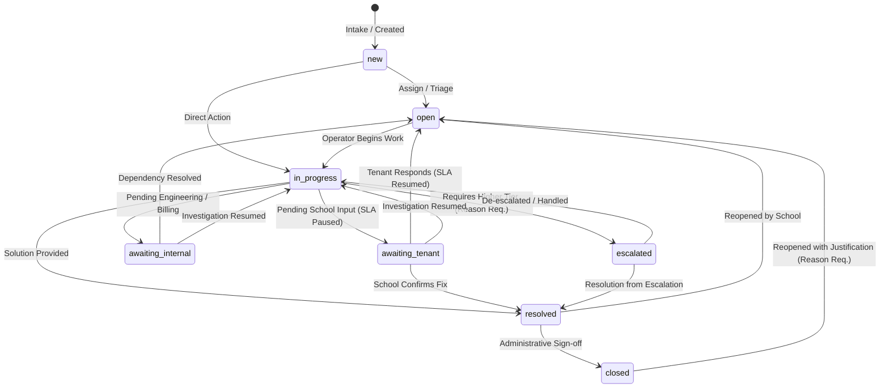

# Phase E-09.17 — Platform Support Desk, Customer Success and Tenant Assistance Governance

## 1. Executive Summary & Architecture Overview

Phase **E-09.17: Platform Support Desk, Customer Success and Tenant Assistance Governance** delivers a centralized, enterprise-grade support operations and customer-success governance workspace for Super-Admins in the platform owner application (`dashboard/`).

Prior to E-09.17, platform operators lacked a unified support management desk. Tenant assistance questions, incident linkages, SLA tracking, internal handoffs, customer success engagements, and knowledge-base documentation were fragmented or handled ad-hoc. There was no formal ticket state machine, no SLA breach detection engine, no distinction between confidential internal notes and tenant-facing drafts, and no explainable tenant health scoring.

E-09.17 introduces an integrated **8-tab governance workspace** at `/support`:
1. **Support Operations Overview**: Operational KPI summary (open tickets, unassigned queue, SLA breach counts, approaching targets, escalated tickets, CSAT averages, average first response and resolution times), team queue workloads, and operator switcher.
2. **Support Ticket Registry & Detail Drawer**: Searchable and filterable ticket inventory, quick views (`all`, `my_assigned`, `unassigned`, `high_urgent`, `awaiting_response`, `sla_at_risk`, `escalated`, `recently_resolved`), quick lifecycle actions, formula-safe CSV export, and a slide-over detail drawer with SLA timers and timeline history.
3. **Internal Notes & Communication Composer**: Clear, uncompromised separation between private operator notes and tenant-facing reply drafts, with simulation warnings and zero live dispatches.
4. **SLA Policy Management & Sandbox**: Configurable service-level agreement policies (first-response and resolution targets per priority, business hours calendars, time zones, escalation thresholds) and an interactive simulation sandbox for evaluating policy rules.
5. **Customer Success Accounts & Explainable Health Index**: Multi-tenant institutional health overview with documented, explainable deduction scoring (100 baseline minus active tickets, breaches, dunning, and configuration blockers) and detailed breakdown drawers.
6. **Follow-Up Tasks Board**: Local customer-success task management with owner assignments, due dates, overdue detection, and completion audits.
7. **Knowledge Base Article Management**: Support article repository categorized across 12 SaaS support domains, status transitions (`draft`, `published`, `archived`), and safe Markdown preview modal.
8. **Customer Satisfaction (CSAT) & Review Feed**: 1-to-5 star feedback records, category histograms, positive satisfaction rate calculations, and supervisor review notes.
9. **Support Reporting & Analytics**: Visual aggregate reports, distribution by category and priority, operator workload distribution, and repeated tenant issue tracking.

---

## 2. Repository Findings & Prior Phase Integration

During preliminary repository inspection, existing platform capabilities were evaluated and integrated without duplication:
1. **Super-Admin Navigation & Layout**:
   - `dashboard/components/layout/Sidebar.tsx`: Integrated `Support & Tenant Success` under **Operations & Settings** at `/support` with `LifeBuoy` icon and real-time open ticket count badge.
   - `dashboard/components/layout/TopBar.tsx`: Registered breadcrumb mapping for `/support` -> `Support & Tenant Success`.
2. **Organization Registry (E-09.6 / E-09.7)**:
   - Reused existing `Organization` records (`INITIAL_ORGANIZATIONS`) for ticket references, tenant context, and customer-success accounts.
   - Enforced referential integrity: tickets cannot be created against unresolved organizations.
3. **Platform Users & Operators (E-09.12)**:
   - Reused existing `PlatformUser` records (`INITIAL_PLATFORM_USERS`) for ticket assignees, task owners, and review actors.
4. **Subscription Plans & Monetization (E-09.11)**:
   - Reused existing subscription tiers (`plan_starter`, `plan_growth`, `plan_enterprise`) and subscription statuses for customer success dunning detection.
5. **System Health & Incident Management (E-09.14)**:
   - Preserved distinct identities between platform incidents (`PlatformIncidentNotice`) and support tickets (`SupportTicket`). Support tickets can link to related technical incidents without conflating customer assistance with system outages.
6. **Platform Audit Trail (E-09.13)**:
   - Integrated with standard `logAuditEvent()` contract. Every ticket creation, status transition, assignment, escalation, SLA policy creation, KB edit, CS task mutation, and CSAT review automatically records structured audit logs.
7. **Frontend-First Scope Guarantee**:
   - All code is strictly localized to `dashboard/`. `tenant-dashboard/` is completely untouched.
   - Zero backend routes, databases, server workers, or third-party helpdesk SDKs were created.

---

## 3. Support Categories & Team Queues Taxonomy

### 3.1 Supported Categories (12 SaaS Domains)

| Category Key | Label | Scope |
| :--- | :--- | :--- |
| `account_access` | Account Access & Authentication | SSO, login lockouts, password resets, 2FA recovery |
| `org_onboarding` | Organization Onboarding | School setup, campus initialization, domain validation |
| `student_information` | Student Information & Records | Student profiles, guardian links, enrollment records |
| `academic_management` | Academic Management & Grading | Timetables, subject setup, gradebook configurations |
| `examinations_cbt` | Examinations & CBT Sync | Computer-based testing, offline sync, scoring |
| `billing_subscriptions` | Billing & SaaS Subscriptions | Invoicing, plan upgrades, payments, receipts |
| `communications` | Communications & Delivery | Email/SMS alerts, broadcast issues, delivery failures |
| `integrations_api` | Integrations & API Access | Webhooks, SIS sync, payment gateways, REST APIs |
| `performance_latency` | Platform Performance & Latency | Slow page loads, timeouts, database sync delays |
| `security_compliance` | Security & Compliance Oversight | Audit logs, permissions, suspicious access alerts |
| `data_reporting` | Data Reporting & Exports | Custom reports, analytics exports, data retention |
| `general_assistance` | General Platform Assistance | Feature inquiries, navigation help, user training |

### 3.2 Platform Support Team Queues

1. `team_tier1`: **Tier 1 Customer Support** (General inquiries, onboarding, basic configuration).
2. `team_tier2`: **Tier 2 Technical Support** (CBT offline sync, gradebook calculations, data import).
3. `team_billing`: **Billing & Subscription Success** (Invoices, payment reconciliation, plan upgrades).
4. `team_infrastructure`: **Engineering & Systems** (API integrations, latency, system outages).
5. `team_customer_success`: **Customer Success & Governance** (Account health, training, quarterly reviews).

---

## 4. Ticket Lifecycle State Machine & Valid Transitions

Support tickets adhere to a strict linear finite state machine with transition reason requirements where appropriate:

### Transition Enforcement Rules
- `new` cannot transition directly to `resolved` or `closed` without triage.
- `escalated` requires a mandatory justification of at least 10 characters.
- `reopened` from `closed` requires a mandatory audit rationale.
- Invalid state jumps (e.g. `new` -> `resolved`, `closed` -> `in_progress`) are strictly rejected by the validator with human-readable error messages.

---

## 5. SLA Policy Architecture & Evaluation Engine

### 5.1 Service-Level Agreement Policies

SLA policies define contractual and operational targets evaluated against ticket timestamps:
- **First Response Target**: Maximum minutes allowed between ticket creation (`createdAt`) and first operator response (`firstResponseAt`).
- **Resolution Target**: Maximum minutes allowed between ticket creation and ticket resolution (`resolvedAt`).
- **Target Escalation Thresholds**: Configurable percentage of elapsed SLA target (e.g., 75%) before flagging a ticket as `approaching_target`.

| Policy Tier | Applicable Plans | Urgent Target (Resp / Res) | High Target (Resp / Res) | Normal Target (Resp / Res) |
| :--- | :--- | :--- | :--- | :--- |
| **Enterprise Gold** | Enterprise | 15 min / 2 hrs | 60 min / 6 hrs | 4 hrs / 12 hrs |
| **Growth Silver** | Growth | 30 min / 4 hrs | 2 hrs / 12 hrs | 8 hrs / 24 hrs |
| **Starter Standard** | Starter / Trial | 60 min / 8 hrs | 4 hrs / 24 hrs | 24 hrs / 48 hrs |
| **Exams Critical** | All Plans (CBT tag) | 10 min / 1 hr | 30 min / 3 hrs | 2 hrs / 8 hrs |

### 5.2 Deterministic SLA Evaluation Formula

The evaluation engine calculates:
1. `firstResponseElapsedMinutes = (firstResponseAt || now) - createdAt`
2. `resolutionElapsedMinutes = (resolvedAt || now) - createdAt`
3. **Pause Mechanics**: When status is `awaiting_tenant`, the SLA timer is marked as `paused` because the resolution delay is outside the platform operator's control.
4. **State Classification**:
   - `breached`: Elapsed minutes exceed the policy target.
   - `approaching_target`: Elapsed minutes exceed 75% of the policy target and the ticket is unresolved.
   - `within_target`: Elapsed minutes are under 75% of the policy target.
   - `paused`: Active ticket is waiting for tenant information.
   - `unknown`: Ticket creation timestamp is missing or invalid.

### 5.3 SLA Simulation Sandbox
Super-Admins can test hypothetical ticket parameters in an interactive sandbox without touching production records:
- Adjust policy selection, priority, status, elapsed minutes, and response state.
- Instantly inspect first-response and resolution evaluation results, target thresholds, and human-readable explanations.

---

## 6. Internal Notes vs. Tenant Communication History

### 6.1 Absolute Separation of Message Types
To prevent accidental disclosure of confidential operator comments or internal platform notes:
- **Internal Note (`internal_note`)**: Private yellow-badged message visible only to platform Super-Admins and support staff. Explicitly labeled `Confidential Internal Note — Never visible to tenant users`.
- **Tenant Reply Draft (`tenant_reply`)**: Outgoing message intended for the school requester. Stored locally with `isDraft: true`.
- **System Event (`system_event`)**: Chronological audit trail records documenting status transitions, operator reassignments, and escalations.

### 6.2 Simulation-Only Compose Banner
The response composer displays a persistent warning banner:
> `[DEMONSTRATION ONLY]` Submitting this form updates local demonstration state only. No real email, SMS, push notification, or tenant-facing message is dispatched.

---

## 7. Knowledge Base Article Management

A lightweight platform documentation catalog supports school self-service preparation:
- Fields: `id`, `title`, `summary`, `category`, `content` (Markdown), `tags`, `status` (`draft`, `published`, `archived`), `authorId`, `viewCount`, `helpfulVotes`.
- Features: Category tabs, search filtering, Markdown preview modal with rendered typography, and create/delete article actions.

---

## 8. Customer Satisfaction (CSAT) Governance

Customer feedback records capture school experience following ticket resolution:
- **Rating Scale**: 1 to 5 stars (`1: Very Dissatisfied`, `2: Dissatisfied`, `3: Neutral`, `4: Satisfied`, `5: Very Satisfied`).
- **Rating Validation**: The store and validator reject ratings outside 1-5.
- **Metrics**: Displays average CSAT, total submissions, positive score rate (ratings >= 4), and rating histogram distribution.
- **Review Workflow**: Super-Admin can review feedback, add QA notes, and mark records as audited.

---

## 9. Customer Success Accounts & Explainable Health Index

### 9.1 Explainable Health Index Model (0-100 Baseline)
Rather than an opaque, fabricated score, the health index starts at a **100 baseline** and applies documented, transparent deductions based on observable operational data:

| Operational Condition | Deduction Points | Rationale |
| :--- | :--- | :--- |
| **Urgent Open Ticket** | -15 per ticket | Critical operational blocker actively impacting the school. |
| **High Priority Open Ticket**| -8 per ticket | High-impact workflow issue. |
| **Normal Priority Open Ticket**| -3 per ticket | Standard inquiry or configuration request. |
| **Active SLA Breach** | -12 per breach | Failure to meet service-level response/resolution commitment. |
| **Overdue Follow-Up Task** | -10 per task | Customer-success commitment missed by platform staff. |
| **Subscription Past Due** | -20 points | Account is in commercial dunning/billing suspension risk. |
| **Negative CSAT Rating** | -10 per rating <= 2 | Dissatisfied feedback from school leadership. |
| **Pending Onboarding** | -5 points | Campus configuration readiness is incomplete. |

### 9.2 Transparency Drawer
Clicking any school's health badge opens a slide-over drawer displaying:
- Exact score breakdown and itemized deduction list.
- Subscription tier and renewal date.
- Open tickets count and priority distribution.
- Overdue tasks and recent feedback summary.
- Quick actions: Create support ticket, assign follow-up task.

---

## 10. Follow-Up Tasks & Engagement History

Customer success teams track commitments through a dedicated task board:
- Fields: `id`, `title`, `description`, `organizationId`, `assignedOwnerId`, `priority`, `status` (`pending`, `in_progress`, `completed`, `cancelled`), `dueDate`, `relatedTicketId`.
- Features: Overdue task detection (compared against deterministic reference dates), priority badges, create task modal with validation, and complete task modal with completion notes.

---

## 11. Support Reporting, Analytics & CSV Export

### 11.1 Analytics Metrics
- Total ticket volume, open tickets, unassigned tickets, and escalated count.
- Priority distribution (Urgent, High, Normal, Low) with visual workload bars.
- Ticket status distribution across the lifecycle state machine.
- Team queue allocation and operator load.
- Top recurring support categories and repeated issues by school institution.

### 11.2 Formula Injection Protection in CSV Exports
All CSV exports (`Tickets`, `CSAT Feedback`, `Customer Success Summaries`) pass through `escapeCsvFormulaInjection()` to neutralize spreadsheet formula execution:
- Leading characters `=`, `+`, `-`, `@`, `\t`, `\r` are prefixed with a single apostrophe (`'`) and double-quoted.
- Headers include the mandatory `# [DEMONSTRATION ONLY]` governance banner.
- Student, parent, and teacher personal identifiable information (PII) is strictly excluded.

---

## 12. Verification & Test Coverage

### 12.1 Automated Test Suite
All 365 tests in `dashboard/` pass cleanly without errors:
- **Test File**: `dashboard/tests/support-desk-governance.test.ts`
- **Command**: `npm test`
- **Outcome**: `pass 365, fail 0` in ~1.2s.

Test coverage domains:
1. **Ticket Lifecycle & State Machine**: State transitions, illegal transition rejection, required field validation, and timeline logging.
2. **Assignment & Escalation Governance**: Operator reassignment, queue filtering, and mandatory escalation justification.
3. **SLA Engine & Deterministic Calculations**: First-response calculations, resolution calculations, pause during `awaiting_tenant`, breach thresholds, and missing timestamp safety.
4. **Internal Notes vs. Tenant Drafts**: Absolute separation of message types and chronological ordering.
5. **Customer Success Health Index**: Baseline 100 deduction model, transparency, and follow-up task tracking.
6. **Knowledge Base & CSAT**: Article lifecycle, rating scale validation (1-5), and review workflow.
7. **CSV Exporter & Formula Injection**: Formula neutralization and student PII protection.
8. **Platform Store Mutations & Audit Trail**: Verification that ticket mutations emit structured audit events.

### 12.2 Production Build Verification
- **Command**: `npm run build`
- **Outcome**: `Compiled successfully in 888ms`, TypeScript finished in 4.2s, 61/61 static pages generated including `/support`. Exit code 0.

### 12.3 Lint Verification
- **Command**: `npx eslint --quiet .`
- **Outcome**: `Exit code 0` across all files in `dashboard/`. Impure `Date.now()` calls in render paths were eliminated in favor of deterministic constants.

---

## 13. Demonstration Data Limitations & Boundaries

1. **Local State Only**: All ticket modifications, status transitions, SLA calculations, and follow-up tasks mutate local in-memory store state. No records are persisted to a live database.
2. **No Real Notifications**: Composing tenant replies does not trigger real emails, SMS, push alerts, or tenant notifications.
3. **Simulated SLA Clock**: SLA calculations operate against recorded timestamps and deterministic test anchors rather than active background daemon timers.
4. **No Real Customer Data**: All school organizations, ticket subjects, requester names, and feedback comments are synthetic demonstration fixtures with zero real-world student or teacher personal information.

---

## 14. Next Recommended Phase

Upon completion of E-09.17, proceed to:

**E-09.18 — Platform Analytics, Business Intelligence and Executive Reporting Governance.**
