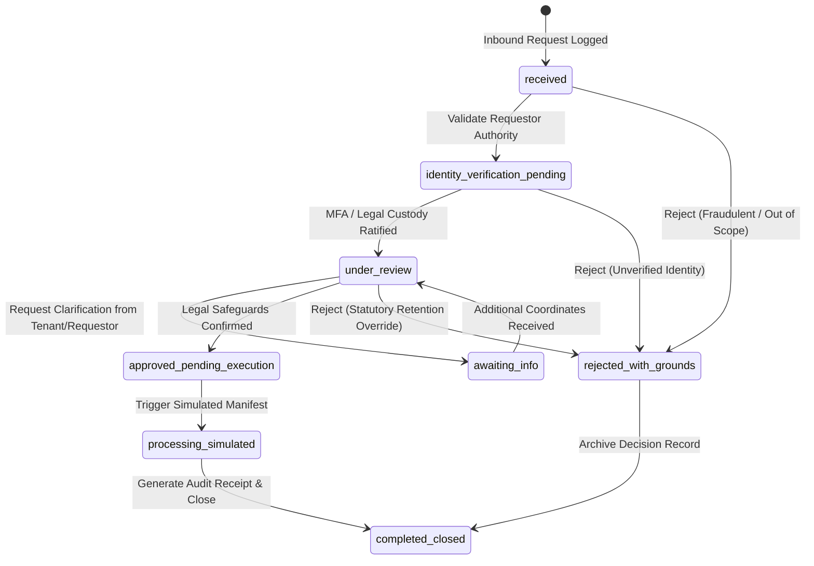

# Phase E-09.20 — Platform Data Governance, Data Retention, Privacy and Lifecycle Management

## 1. Executive Summary & Architecture Overview

Phase **E-09.20: Platform Data Governance, Data Retention, Privacy and Lifecycle Management** delivers a centralized, multi-tenant data privacy, retention scheduling, and lifecycle governance workspace for the Super-Admin dashboard (`dashboard/`).

Prior to E-09.20, data classification, statutory retention obligations, and privacy requests were unmanaged across the multi-tenant SaaS platform. Super-administrators had no unified workspace to:
- Catalog and classify educational and organizational data categories across all school tenants.
- Define and audit statutory retention policies complying with FERPA, GDPR, KCSIE, COPPA, and labor/tax mandates.
- Supervise and simulate Data Subject Access Requests (DSARs) without handling or exposing real Personally Identifiable Information (PII).
- Define deterministic data lifecycle rules controlling cold storage migration, archival, and tombstoned deletion.
- Monitor per-tenant data governance completeness and surface unmapped categories or missing compliance coordinates.
- Maintain policy exceptions and legal hold preservation orders overriding standard deletion schedules.
- Generate tamper-evident audit logs and export governance packages protected against spreadsheet formula injection attacks.

### Core Architectural Pillars

1. **Centralized Data Governance Workspace (`/data-governance`)**:
   - Single-entry enterprise console structured into 8 synchronized tabbed sections:
     1. **Executive Overview**: High-level platform KPIs, classification distribution, privacy request pipelines, lifecycle stage breakdowns, and quick actions.
     2. **Data Inventory**: Comprehensive catalog of 14 educational and organizational data categories, sensitivity classifications, regulatory tags, and modal editing controls.
     3. **Retention Policies**: 8 statutory and institutional retention policies with duration schedules, trigger events, review due dates, and policy review modals.
     4. **Privacy Requests (DSARs)**: Simulated end-to-end privacy workflow pipeline with linear state machine validation, identity review, and synthetic export manifest generation.
     5. **Lifecycle Rules**: Automated data movement policies governing active use, cold storage tiering, archival, and scheduled deletion.
     6. **Tenant Governance**: Multi-tenant compliance aggregation evaluating classification coverage, policy assignment, and completeness scoring for all registered school organizations.
     7. **Policy Exceptions**: Formal legal hold and statutory exemption registry overriding default retention horizons.
     8. **Governance Audit**: Immutable administrative event trail tracking classification adjustments, policy approvals, request transitions, and export operations.
     9. **Architecture & Docs**: Interactive compliance reference, educational privacy regulation matrix, and future production backend readiness specification.

2. **Honest Operational Status & Simulated Guardrails**:
   - The workspace strictly distinguishes between active demonstration state, static configuration, and verified production connectivity.
   - All components display explicit honesty badges: `demo_fixture`, `static_config`, `simulated`, `unverified`, and `enforcement_unknown`.
   - Retention policy execution and privacy data generation run entirely through deterministic client-side evaluator engines without destructive database operations.

3. **Zero-PII & Privacy-First Architecture**:
   - Strictly zero personal records (student names, home addresses, phone numbers, email addresses, national identity numbers) are collected, processed, or exposed.
   - All data subjects and privacy requestors utilize synthetic fictional descriptors (e.g., `Parent Representative for Pupil ID #7821`, `Staff Representative for Faculty #1042`).
   - Export bundles and manifests contain only synthetic schemas and field counts.

4. **Spreadsheet Formula Injection Defense**:
   - All CSV and JSON export pipelines utilize cell sanitization (`sanitizeCsvCell`) that detects and neutralizes formula injection triggers (`=`, `+`, `-`, `@`, `\t`, `\r`) with single-quote escaping pursuant to OWASP guidelines.

---

## 2. Implemented Routes & Navigation Integration

### 2.1 Route Inventory

| Route | View Purpose | Access Control | Reused Dependencies |
| :--- | :--- | :--- | :--- |
| `/data-governance` | Primary Platform Data Governance, Retention, Privacy & Lifecycle Workspace | Super-Admin (`super_admin`, `platform_auditor`, `compliance_officer`) | `Sidebar`, `TopBar`, `usePlatformStore`, `Tabs`, `GovernanceNotice`, 8 Tab Views, Review & Edit Modals |

### 2.2 Deep-Linkable Tab Navigation

The workspace supports URL search parameters (`?tab=...`) to ensure direct linking, bookmarking, and sub-navigation across all 8 views:
- `?tab=overview`
- `?tab=inventory`
- `?tab=retention`
- `?tab=privacy`
- `?tab=lifecycle`
- `?tab=tenants`
- `?tab=exceptions`
- `?tab=audit`
- `?tab=docs`

### 2.3 Navigation Integration

- **Sidebar (`dashboard/components/layout/Sidebar.tsx`)**:
  - Registered `Data Governance` under the **Compliance & Governance** navigation group with a `ShieldAlert` Lucide icon.
  - Dynamically displays an amber notification badge when privacy requests or retention policies require administrator review.
  - Positioned adjacent to `Audit & Compliance` and `Security Overview` for operational coherence.
- **TopBar (`dashboard/components/layout/TopBar.tsx`)**:
  - Dynamic breadcrumb resolution mapping `/data-governance` -> `Data Governance`.

---

## 3. Data Inventory & Classification Schema

The platform implements a standardized 4-tier data classification hierarchy tailored to educational institutions:

### 3.1 Classification Levels

| Level | Badge Color | Handling Requirements | Educational Examples |
| :--- | :--- | :--- | :--- |
| **Public** | Slate / Gray | Openly accessible; no encryption required at rest. | School calendar, published curriculum syllabi, public campus directories. |
| **Internal** | Blue / Sky | Accessible to authenticated platform users; encrypted in transit. | Platform routing metadata, school organizational hierarchy, academic term calendars. |
| **Confidential** | Amber / Orange | Restricted to authorized personnel; encrypted at rest (AES-256) and in transit (TLS 1.3). | Parent contact coordinates, prospective admissions, daily attendance registers, library loans. |
| **Restricted** | Rose / Red | High-risk sensitive personal data; strict role-based isolation, field-level encryption, WORM logging. | Student cumulative transcripts, safeguarding/welfare notes, pupil medical records, staff payroll/DBS tokens. |

### 3.2 Inventory Catalog (14 Baseline Educational Categories)

| Category Code | Category Name | Subject Type | Classification | Owning Module | Default Retention Policy |
| :--- | :--- | :--- | :--- | :--- | :--- |
| `DATA-ORG-01` | Organization & Campus Metadata | Organization | Internal | Platform Core | Core School Organizational Structure (`ret_pol_org_meta`) |
| `DATA-STU-01` | Student Biographical & Enrollment | Student | Restricted | SIS | Cumulative Transcripts & Core Student Record (`ret_pol_permanent_transcript`) |
| `DATA-PAR-01` | Parent & Guardian Coordinates | Guardian | Confidential | SIS | Parent & Guardian Emergency Coordinates (`ret_pol_guardian_contacts`) |
| `DATA-STF-01` | Staff Personnel & Payroll Records | Staff | Restricted | HR Governance | Staff Personnel & Statutory Tax Records (`ret_pol_staff_employment`) |
| `DATA-ADM-01` | Prospective Student Admissions | Applicant | Confidential | Admissions | Unsuccessful Admission Applications (`ret_pol_admissions_unsuccessful`) |
| `DATA-ACA-01` | Academic Grades & Transcripts | Student | Restricted | Academics | Cumulative Transcripts & Core Student Record (`ret_pol_permanent_transcript`) |
| `DATA-CBT-01` | CBT Raw Examination Sessions | Student | Internal | CBT Center | CBT Item Responses & Examination Telemetry (`ret_pol_cbt_session_logs`) |
| `DATA-SAF-01` | Student Safeguarding & Welfare | Student | Restricted | Pastoral Care | Safeguarding & Child Protection Files (`ret_pol_safeguarding_age25`) |
| `DATA-HLT-01` | Pupil Health & Emergency Directives | Student | Restricted | Health Services | Safeguarding & Child Protection Files (`ret_pol_safeguarding_age25`) |
| `DATA-FIN-01` | Tuition Billing & Invoices | Organization | Confidential | Finance & Billing | Tuition Billing & Fiscal Ledger Records (`ret_pol_financial_ledger`) |
| `DATA-ATT-01` | Daily Attendance Logs | Student | Confidential | Attendance | CBT Item Responses & Examination Telemetry (`ret_pol_cbt_session_logs`) |
| `DATA-LIB-01` | Library Resource Loans | Student | Internal | Library Services | CBT Item Responses & Examination Telemetry (`ret_pol_cbt_session_logs`) |
| `DATA-AUD-01` | Platform Security & Audit Logs | System | Confidential | Security Core | Tuition Billing & Fiscal Ledger Records (`ret_pol_financial_ledger`) |
| `DATA-SUP-01` | Support Tickets & Inquiries | Organization | Internal | Support Desk | Unsuccessful Admission Applications (`ret_pol_admissions_unsuccessful`) |

---

## 4. Statutory & Institutional Data Retention Policies

The platform defines 8 statutory retention policies mapped to international educational compliance frameworks:

| Policy Code | Policy Name | Covered Categories | Retention Duration | Retention Trigger | Legal Safeguard Basis |
| :--- | :--- | :--- | :--- | :--- | :--- |
| `RET-STU-PERMANENT` | Cumulative Transcripts & Permanent Record | `cat_student_records`, `cat_academic_transcripts` | Permanent (36,500 days) | `student_graduation_or_departure` | FERPA (34 CFR § 99.31) / State Cumulative Record Mandates (100-year archive) |
| `RET-SAF-KCSIE-25` | Safeguarding & Child Protection Files | `cat_safeguarding_welfare`, `cat_health_medical` | 9,125 days (25 yrs post-birth) | `statutory_requirement` | UK Keeping Children Safe in Education (KCSIE) & Goddard Inquiry Recommendations |
| `RET-STF-LABOR-07` | Staff Personnel & Statutory Tax Records | `cat_staff_records` | 2,555 days (7 years) | `contract_termination` | Statutory Tax Revenue Code & National Labor Standards Acts |
| `RET-FIN-TAX-07` | Tuition Billing & Fiscal Ledger Records | `cat_billing_invoices`, `cat_audit_security_logs` | 2,555 days (7 years) | `academic_year_completion` | International Financial Reporting Standards (IFRS) & Statutory Tax Audits |
| `RET-CBT-LOGS-01` | CBT Telemetry & Examination Sessions | `cat_exam_cbt_attempts`, `cat_attendance_logs`, `cat_library_loans` | 365 days (1 year) | `record_creation` | Assessment Board Quality Assurance Guidelines & Exam Appeal Window |
| `RET-ADM-APPLICANT-02` | Unsuccessful Admission Applications | `cat_admissions`, `cat_support_tickets` | 730 days (2 years) | `academic_year_completion` | Equal Educational Opportunities Act (EEOA) & Admissions Appeal Limits |
| `RET-PAR-CONTACTS-01` | Parent & Guardian Coordinates | `cat_parent_guardian` | 365 days (1 year) | `student_graduation_or_departure` | GDPR Data Minimization (Art. 5(1)(c)) Post Pupil Departure |
| `RET-ORG-PERMANENT` | Core School Organizational Structure | `cat_org_meta` | Permanent (-1 days) | `statutory_requirement` | Multi-Tenant Platform Master Routing Registry |

### 4.1 Policy Review Lifecycle

- Retention policies enforce review intervals.
- The platform evaluates whether a policy is `current`, `due_soon` (within 30 days), or `overdue`.
- Administrators can invoke `ReviewRetentionPolicyModal` to record review notes and ratify approval (`approved_demo`).

---

## 5. Data Subject Access Requests (DSAR) & Privacy Workflow Management

The privacy module implements a rigorous, audit-logged workflow engine for handling Subject Access Requests, Erasure Requests, Rectification Inquiries, and Objections.

### 5.1 Privacy Request State Machine



### 5.2 Zero-PII Simulation Engine

- **Access / Portability Requests**: Generates a synthetic JSON manifest (`PrivacySimulatedArtifact`) containing metadata fields, category mappings, and field counts without exposing live pupil data.
- **Erasure / Deletion Requests**: Rather than executing destructive physical database deletes, the engine generates an immutable **Tombstone Receipt** detailing non-reversible simulated anonymization and records statutory overrides if records are subject to permanent retention (e.g., student transcripts).
- **Statutory Conflict Resolution**: When a deletion request conflicts with mandatory retention (e.g., `RET-STU-PERMANENT`), the engine enforces rejection with clear statutory grounds (`rejected_statutory_retention_override`).

---

## 6. Data Lifecycle Rules & Storage Tiering

The platform models 6 automated lifecycle rules managing the data journey across progressive storage tiers:

| Rule Code | Rule Name | Target Stage | Trigger Event | Approval Level | Status |
| :--- | :--- | :--- | :--- | :--- | :--- |
| `LCR-EXAM-ARCHIVE` | Archive Examination & CBT Telemetry | `archived` | Inactivity Threshold (90 days) | `platform_super_admin` | Enabled |
| `LCR-ADM-PURGE` | Purge Incomplete Admission Enquiries | `scheduled_deletion` | Retention Expiry (2 years) | `dpo_officer` | Enabled |
| `LCR-ATTENDANCE-COLD` | Move 3-Year Attendance Logs to Cold Storage | `restricted_inactive` | Inactivity Threshold (3 years) | `platform_super_admin` | Enabled |
| `LCR-FIN-RESTRICT` | Enforce Read-Only Archival on 7-Year Invoices | `archived` | Retention Expiry (7 years) | `super_admin_dual_key` | Enabled |
| `LCR-SAFEGUARD-LEGAL` | Legal Hold on Pupil Safeguarding Files | `retained_exception` | Legal Hold Released (Conditional) | `dual_authorization` | Enabled |
| `LCR-TENANT-OFFBOARD` | Tombstone Offboarded Tenant Data | `anonymized_demo` | Tenant Offboarding (180 days) | `dpo_officer` | Disabled |

---

## 7. Multi-Tenant Governance Oversight & Completeness Scoring

The Super-Admin console computes aggregate data governance metrics across all registered school tenants:

### 7.1 Completeness Criteria

1. **Classification Coverage**: Percentage of mapped data categories backed by an active retention policy.
2. **Review Currency**: Flags tenants with policies or exceptions overdue for compliance review.
3. **Contact & Technical Metadata**: Detects missing technical routing (`subdomain`) or primary data protection contact coordinates (`contact.email`).
4. **Completeness Badges**:
   - `complete`: 100% coverage, current reviews, complete contact metadata.
   - `review_required`: Unresolved policy exceptions, pending lifecycle reviews, or pending organization status.
   - `incomplete`: Missing essential contact or routing coordinates.

---

## 8. Policy Exceptions & Legal Holds

The exception registry enables compliance officers and general counsel to place statutory overrides on standard deletion and archival rules:

| Exception Code | Title | Reason Category | Scope / Tenant | Approval Level | Review Status |
| :--- | :--- | :--- | :--- | :--- | :--- |
| `EXC-TAX-2026-01` | National Revenue Authority 10-Year Audit Hold | `statutory_tax_audit` | Springfield Academy | `legal_counsel` | Approved Demo |
| `EXC-LIT-2026-04` | Preservation Order for Employment Dispute | `ongoing_litigation_hold` | Oakridge High School | `legal_counsel` | Approved Demo |
| `EXC-HIST-2026-02` | Historical Century Archival of Founding Registers | `historical_archival` | Grand Valley Grammar School | `board_approval` | Approved Demo |
| `EXC-ACCR-2026-03` | International IB World School Accreditation Review | `accreditation_review` | Riverdale Collegiate | `super_admin_dual_key` | Pending Review |

---

## 9. Administrative Audit Trail & Compliance Transparency

All governance actions produce tamper-evident audit log entries within `platformStore`:
- `DATA_CATEGORY_UPDATED`: Changes to data classification levels, business purposes, or review statuses.
- `RETENTION_POLICY_CREATED` / `RETENTION_POLICY_REVIEWED`: Creation or ratification of statutory retention schedules.
- `PRIVACY_REQUEST_STATUS_UPDATED` / `PRIVACY_REQUEST_SIMULATED_PROCESSING`: Workflow transitions and zero-PII synthetic artifact generation.
- `DATA_LIFECYCLE_RULE_TOGGLED` / `DATA_LIFECYCLE_RULE_CREATED`: Activation or modification of storage tiering rules.
- `GOVERNANCE_EXCEPTION_CREATED` / `GOVERNANCE_EXCEPTION_REVIEWED`: Submission and ratification of legal holds.

---

## 10. Reporting, Safe Exports & Formula Injection Protections

The platform provides export generators for both comprehensive JSON governance packages and sanitized CSV files:
- **OWASP Formula Injection Defense**: All exported cells starting with dangerous characters (`=`, `+`, `-`, `@`, `\t`, `\r`) are prepended with an apostrophe (`'`), preventing malicious spreadsheet command execution.
- **Zero-PII Compliance**: Exports contain only schema definitions, policy rules, synthetic request identifiers, and aggregate metrics.

---

## 11. Verification & Test Suite Results

The automated test suite (`tests/platform-data-governance.test.ts`) validates 31 comprehensive unit tests across 9 functional sections:

```text
▶ Phase E-09.20: Platform Data Governance, Data Retention, Privacy and Lifecycle Management
  ▶ 1. Date & Review Due Calculations (3 tests passed)
  ▶ 2. Centralized Governance KPI Metrics (1 test passed)
  ▶ 3. Inventory & Policy Filtering (8 tests passed)
  ▶ 4. Privacy Request Workflow & State Transitions (4 tests passed)
  ▶ 5. Simulated Privacy Execution - Zero PII Guarantee (2 tests passed)
  ▶ 6. Multi-Tenant Governance Aggregation (2 tests passed)
  ▶ 7. Spreadsheet Formula Injection Defense (4 tests passed)
  ▶ 8. Platform Store State Management & Audit Logging (7 tests passed)
✔ Phase E-09.20: Platform Data Governance (31 passed, 0 failed, 9 suites)
```

- **TypeScript Compilation**: `npx tsc --noEmit` exited with code 0 (0 errors).
- **ESLint Validation**: `npx eslint` exited with code 0 (0 errors, 0 warnings).
- **Full Repository Suite**: `npm test` verified 458 passed tests across 134 suites with 0 failures.
